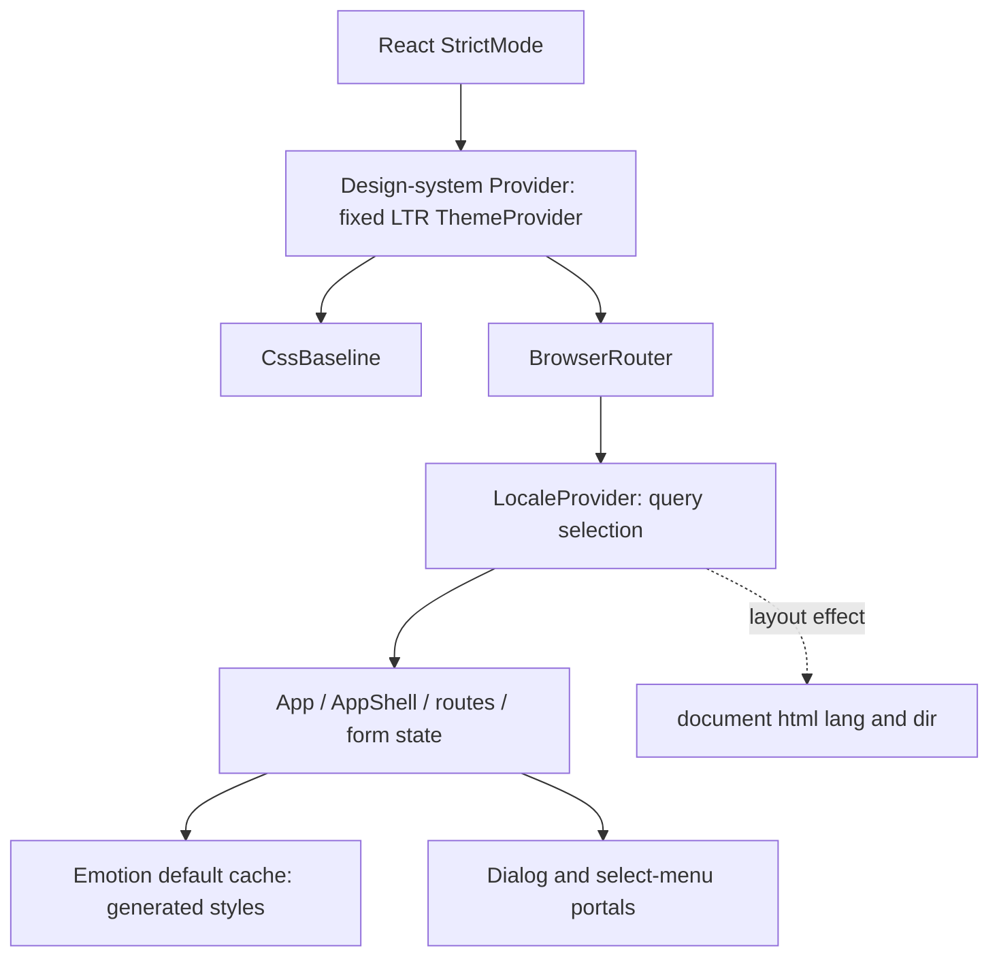
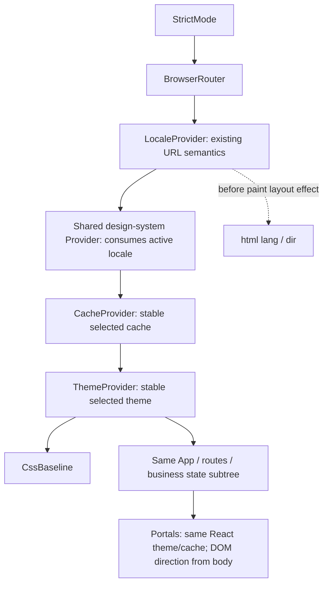

# Phase 4D.1 — Runtime direction contract and compatibility design

Project: **Atlas Invoice — Migrating Enterprise React Apps to RTL Without Breaking LTR**. Coffee Break Web case study. Investigation date: 12 October 2026.

## 1. Executive summary and recommendation

**APPROVE WITH CONDITIONS — design only. Production runtime activation remains blocked pending the compatibility, shell-exclusion and scanner prerequisites below.** Preserve the approved sequence: **4D runtime infrastructure → 4E component fixes → 4F controlled codemod expansion**. No further CSS pilot is authorized.

Recommend one locale-derived direction, a shared design-system runtime owner inside LocaleProvider, stable direction-specific themes/caches, and an unchanged mounted application subtree. Prefer preserving the physical left shell during the first runtime slice, but only after declaration-level processor exclusions are proved in development and production builds. If that proof fails, stop; an atomic shell migration requires separately approved expanded scope. Do not activate processing with a right sidebar and left gutter.

The smallest next stage is **proposed 4D.2: bounded compatibility and scanner-contract prerequisite**, rather than production activation. Exact published plugin compatibility, exclusion survival and bounded cache analysis are not established by the present installed runtime. This document makes the target implementation contract explicit without granting approval to implement it.

Evidence labels: **FACT** means inspected source/package behavior; **HISTORICAL OBSERVATION** means the existing Phase 2A/pilot evidence; **PROPOSAL** means an unapplied design; **UNRESOLVED** means a prerequisite or missing runtime proof. Source locations below refer to this checkpoint, not future edits.

## 2. Repository baseline and reviewed evidence

FACT: branch `feat/phase-3-rtl-scanner`; HEAD `ceeabfdbde3b2fc7d3592b88d54daa6f760905d9`; initially clean, no staged/untracked work. Preflight branch, SHA, status and five-entry log matched expectations. Parent `85f4dde02142f305b434c815a39015a4c5eaafec` contains the approved two-property pilot. No branch switch/reset occurred.

Reviewed approved roadmap; Stage 4A ownership, policies, implementation/regression plans; Stage 4B validation review; Stage 4C.1 semantic, 4C.2 pilot and 4C.2a test-repair reviews; Phase 2A issue catalog; scanner README, runtime rules, policy and historical/live regression test; testing strategy; app entry/routing/state, shared locale/design-system/CSS, Vite configuration and installed package implementations/exports. Older documents contain checkpoint-specific counts and mode proposals; current roadmap/user instruction governs: no new feature flag.

Current approved scanner baseline: 419 facts, 56 entries, 53 actionable and three metadata; 48 MANUAL_REVIEW, five RUNTIME_CONFIG, two INTENTIONAL_LTR, one INFORMATIONAL, zero AUTO_CANDIDATE; complete, nine nonblocking diagnostics. Categories describe review risks, not confirmed rendered bugs or transformation permission. Shared `applications: []` means reachability unresolved.

## 3. Verified current architecture

Both `apps/invoicing/src/main.tsx:8–17` and `apps/procurement/src/main.tsx:8–17` have this hierarchy:



FACT: `libs/shared/src/i18n.tsx:25–56` derives language on each render from the URL. Arabic requires both `demo=unmigrated-rtl` and `lang=ar`; default, invalid-language and `lang=ar`-only URLs are English. Lines 32–35 set document `lang` to ar-EG/en and `dir` to rtl/ltr in a layout effect. Switching changes only search parameters on the same pathname/hash. `demoHref` carries the query through local and absolute links. Locale is not a persisted independent state store.

FACT: `libs/design-system/src/index.tsx:39–79` exports one fixed `direction: "ltr"` theme with palette, typography and symmetric overrides. Provider is above LocaleProvider, so reading locale there currently yields the default context. There is no explicit CacheProvider or active RTL plugin in inspected applications/libraries. Emotion supplies its browser default cache with key `css`, using prefixer; transitive installation of cache/Stylis is not an RTL configuration.

FACT: invoicing App owns loaded invoices at `apps/invoicing/src/App.tsx:14–32`; CreateInvoice owns entered fields, confirmation and error at `pages/CreateInvoice.tsx:24–34`; filters/page state live in Invoices, modal/search state in Customers, settings in Settings. Procurement filters live in `apps/procurement/src/App.tsx:16`. Existing same-route locale updates do not deliberately key/remount these subtrees. This is a source-supported preservation mechanism, not proof that a future wrapper cannot reset state.

FACT: Modal uses MUI Dialog; TextField selects use MUI menu/popover machinery. Ordinary shell/table/SVG content stays in the app DOM. Sidebar is a custom Emotion aside, not a MUI Drawer. No current custom tooltip implementation was found. Generated MUI, sx, theme overrides and Emotion templates use Emotion; imported plain CSS, DOM inline styles and SVG coordinates do not.

## 4. Proposed direction contract and valid provider topology

PROPOSAL: keep the URL-selected language in LocaleProvider as the sole source of truth. Derive `direction = language === "ar" ? "rtl" : "ltr"`; do not maintain a second settable direction or infer it from DOM/cache. Document attributes are outputs, not inputs. Locale formatting remains independently approved and current canonical values/formatters unchanged.



The conceptual locale→document→theme→cache sequence is a **shared-value relationship**, not DOM attributes read sequentially by providers. CacheProvider must enclose ThemeProvider/CssBaseline and styled descendants. Router must precede LocaleProvider because it reads router hooks. The proposed shared Provider is inside LocaleProvider; no conditional wrapping or locale key. Moving the tree once in an approved deployment differs from remounting it on every switch. Audit test/Storybook consumers that render Provider without LocaleProvider; they must retain default English behavior without requiring router hooks in Provider itself.

| Entry / transition | Required behavior after approved implementation |
| --- | --- |
| Default English and opt-in English | html en/ltr, LTR theme and prefixer-only cache; original English pixels/workflows |
| Direct Arabic deep link/reload | URL resolves Arabic before child render; RTL theme/cache chosen in that render; html ar-EG/rtl committed before first React paint |
| English→Arabic→English | Same provider types/positions and App identity; only context values and URL query change; keep pathname/hash, input/filter/modal state |
| Cross-application navigation | Existing full navigation preserves query; destination independently resolves direction before paint; independent app/cache lifetime, no promise of unsaved form transfer |
| Dialog/menu/pagination/table | Active theme/cache follow locale; portals use global direction; column semantics and token policy remain separate |
| Nested LTR content | Text-only islands receive local isolation; no global theme/cache switch for a token; a complete generated LTR widget needs a reviewed matching local theme/cache/portal contract |

Initial-render limit: these are client-rendered English HTML entries. A layout effect prevents a mismatched committed React paint, but cannot promise Arabic direction before JavaScript runs or an error screen loads. Preserve initial HTML exceptions; pre-bootstrap HTML mutation/SSR would require separate approval. Do not write DOM during speculative render. Test initial Arabic in StrictMode and production, not just post-effect values.

State acceptance: no direction-dependent key on Provider, App, routes, forms or Dialog; no conditionally different provider tree. URL updates must not navigate to a new page. Context rerender is expected; a mount-count/DOM-identity probe and data checks must prove no business subtree remount. MUI internal focus/class updates may occur; validate them rather than promise every internal node identity.

Cleanup: keep document synchronization in one locale owner. Existing effect has no cleanup. If true root unmount restoration is needed, capture original attributes once and restore only on final app disposal, not each language effect cleanup; StrictMode replay must be tested. Do not add competing document writers. Stable caches survive locale switches; never flush a live cache on each switch.

## 5. MUI/Emotion compatibility and dependency contract

FACT from current lockfile and installed package metadata:

| Package | Resolved version | Current ownership / exports |
| --- | --- | --- |
| @mui/material | 7.3.11 | Direct; conditional require/default exports and supported component subpaths |
| @emotion/react | 11.14.0 | Direct; named CacheProvider through browser/development/ESM/CJS conditional entry points |
| @emotion/styled | 11.14.1 | Direct; imported custom SidebarFrame template |
| @emotion/cache | 11.14.0 | Transitive; root default createCache export, browser/development conditions |
| stylis | 4.2.0 | Transitive; ESM/CJS package entry points, named prefixer |
| @mui/stylis-plugin-rtl / stylis-plugin-rtl | Not installed | No active plugin or project-verified published export |

[MUI v7.3.11 RTL guidance](https://v7.mui.com/material-ui/customization/right-to-left/) recommends `@mui/stylis-plugin-rtl`, cache processing with `[prefixer, rtlPlugin]`, and template declaration `/* @noflip */` opt-out. It also separates global direction from local portal direction. This is the appropriate candidate for investigation, rather than selecting an arbitrary Stylis-v3 plugin.

[Upstream MUI package metadata](https://raw.githubusercontent.com/mui/material-ui/master/packages/mui-stylis-plugin-rtl/package.json) lists the MUI Team, Stylis peer `4.x`, upstream version 9.4.0 and development Stylis 4.4.0. That establishes current upstream ownership and a major-version-compatible API family, **not** a published, pinned plugin version certified for MUI 7.3.11/Stylis 4.2.0. Master is moving evidence; do not install its version by inference. The v7-tag raw metadata and npm page could not be retrieved in this investigation. Maintenance is evidenced by current official guidance/upstream package, but release cadence and the exact candidate's published exports/transitive engine requirements remain unverified.

UNRESOLVED prerequisite: select an exact published release; record registry integrity, default ESM/CJS/type exports, Stylis peer range, Node requirements, dependency tree, upstream tests/release history and actual Vite dev/production execution with installed versions. Do not upgrade MUI/Emotion to make an unreviewed candidate fit. No package compatibility experiment or installation was performed here.

Future imports require direct pinned runtime dependencies for @emotion/cache (candidate 11.14.0), stylis (candidate 4.2.0) and the approved exact RTL plugin release; existing @emotion/react already direct. Root package.json/lockfile own dependencies for both apps. No new dependency is authorized by this design. [Emotion cache documentation](https://emotion.sh/docs/@emotion/cache) confirms custom plugin arrays replace the default prefixer behavior and multiple caches require distinct keys.

## 6. Cache ownership, insertion and lifecycle

PROPOSAL: design system owns the generated-style runtime implementation; app shells only compose Router→LocaleProvider→Provider. Shared localization supplies language without importing design-system runtime, avoiding a reversed dependency cycle. Both apps use the same implementation, separate instances per browser document.

Create each direction cache once per mounted document/runtime owner; never per render or locale update. Proposed LTR key `css` preserves existing generated-class prefix; RTL key `atlas-rtl` is distinct and valid. Only one owned `css` instance may supply application styles; do not leave descendants using a parallel implicit default cache. StrictMode initialization must be idempotent; a document-scoped registry created by the approved bootstrap/factory avoids duplicate cache creation. Test disposal/HMR and multiple roots explicitly. SSR is out of current scope; a browser singleton must not later become a shared cross-request server cache.

Keep the exact current LTR theme object/values. Build a stable RTL counterpart with the same palette/typography/overrides and only direction changed. Keep both available rather than rebuilding them with every query update. Literal direction configurations are easier to analyze, but the scanner must understand active selection; the existence of an unused LTR theme is not a runtime mismatch proof.

LTR plugins: prefixer only. RTL plugins: prefixer then the approved plugin, once. No second RTL processor, StyledEngineProvider injection layer or separately mirrored generated CSS. Use document.head and the current append semantics initially (no prepend/injectFirst/new HTML insertion anchor). Both caches must use the same precedence relative to imported plain CSS in development and production; inspect actual tag/CSS order. A dedicated insertion point is deferred unless an observed precedence problem requires explicit expanded scope.

Installed Emotion implementation: default cache key css; createCache chooses `options.stylisPlugins || [prefixer]`, and sheet supports container/prepend/insertionPoint. CacheProvider is a React context provider, so changing its value does not inherently remount children. Component sheets retain inserted/registered entries; Global creates a separate sheet and flushes it when its cache effect cleans up (`node_modules/@emotion/react/dist/emotion-react.browser.development.esm.js:364–432`). Thus CssBaseline global tags may be replaced legitimately during switches; do not require zero tag churn.

Acceptance: direction-specific class prefixes and rules cannot share a key; inactive component rules may remain cached but must not apply to active classes. After both directions are warmed, repeated cycles must not monotonically grow duplicate rules/style tags for identical states. Global baselines must have only the active applicable set. Do not flush inactive cache.sheet while retaining its inserted map: that could prevent reinsertion on return. Final disposal must dispose owned sheets/registry together after descendants unmount, including Global lifecycle; no cleanup during direction changes. Exact disposal/HMR behavior remains a fixture/browser prerequisite.

## 7. CSS ownership and double-flipping safeguards

| Surface / source | Owner and actual consumers | Proposed treatment | Double-flip / coordination safeguard |
| --- | --- | --- | --- |
| styles.css / shared demo.css | Imported plain CSS; both shells/shared components, dashboard selectors only invoicing | Reviewed logical/manual changes in 4E/4F; no global rewrite in 4D | Bypasses Stylis; plugin cannot fix left gutter or KPI geometry |
| .status-dot :385; .chart-legend i :299 | Plain CSS, both StatusBadge consumers / invoicing chart | Preserve approved logical end gaps 6px/7px | Do not add physical mirror or process stylesheet a second time |
| CSS variables | No current custom-property chain identified in supported app/lib scope | Future consumer/definition semantics required | Do not promise unresolved variable substitution/mirroring |
| SidebarFrame index.tsx:213–231 | Custom Emotion; both AppShells | Verified physical shell exclusions first; later coordinated 4E migration | Preserve left/border/motion together with plain gutter; no subtree LTR cache |
| Theme overrides, generated controls | MUI/Emotion; both main entry trees | Active theme + one approved RTL processor | Theme direction is not generated physical-CSS rewriting by itself |
| FormField, Modal sx, DataTable | Generated MUI + custom Emotion; forms/tables both apps; Modal source usage invoicing | Runtime first, then manual remaining geometry/content | Right:12 close sx may be transformed; never independently hand-swap it too |
| Other custom sx/templates | Custom Emotion review owner | Inventory asymmetry before activation; assign processor-owned physical or explicitly excluded semantic effect | No blanket noflip promise for object sx; aliases/numeric units remain MUI semantics |
| React style objects | Custom inline, e.g. Dashboard:180 and Invoices:56 | Explicit semantic review later | Bypasses cache; preserve React pixel units, no assumed theme-spacing conversion |
| Latin brand / token islands | HTML/plain CSS/content; shared brand both apps | Manual isolation in 4E; intact canonical content | Local dir does not disable an ancestor RTL cache; no global SVG mirror |
| SVG revenue / donut | SVG geometry + plain/inline; invoicing Dashboard | Preserve data/coordinates; manual label flow in 4E | No processor-owned chronology/data reversal |

No ownerOverrides/semantic approvals are proposed now. Unknown ownership stays unresolved. Imported shared components show both-app consumers, but this does not fabricate a full dependency graph. Generated MUI policy owner remains separate from custom Emotion ownership. Specificity/order and physical/logical companion conflicts must be checked in computed styles, not assumed safe because property names are logical.

## 8. Shell decision: preserve versus migrate atomically

FACT: `SidebarFrame` has fixed left:0, width:238px, border-right and mobile translateX(-100%) with open translateX(0). `styles.css:114` independently reserves margin-left:238px; :502 resets it at max-width 900px; :561 resets for print and hides aside. Active nav border/padding are also plain CSS. Global processing can change only the template half. Phase 2A did **not** observe a broken hidden right drawer or shell overlap: the original left pair worked, albeit contrary to intended RTL reading-start placement.

| Approach | Implementation contract / risk | Decision |
| --- | --- | --- |
| A: preserve physical legacy shell | Apply tested declaration-level noflip annotations to directional template edges/border/transform, including nested media/open rules as needed. Preserve physical gutter/resets unchanged. Text remains Arabic RTL. Annotation survival and exact computed output must be proved for chosen plugin and production serializer. | Preferred initial runtime boundary **conditionally**; preserves current shell but deliberately leaves RTL-01 unresolved |
| B: atomic shell migration | Together change anchor, opposite edge, border, content reservation/reset, closed-motion sign, open state, nav edges, responsive and print behavior. One layout contract across Emotion/plain CSS. | Larger scope/English risk; requires separately approved shell semantics and 4E scope coordination |

Do not assume per-selector plugin disable exists. Official evidence supports a template comment for declarations; it does not prove every nested block/transform or object representation in this build. Test the exact existing template with pinned processor, then a rendered shell. A prefixer-only CacheProvider around the entire Sidebar would also give its MUI descendants an LTR pipeline, so it is rejected as an unverified shortcut. A distinct isolated styled leaf could be explored only with proof of cache restoration for child generated styles; it is not the chosen design.

A acceptance: desktop aside x=0,width=238 and content reservation matches; closed mobile left drawer fully outside viewport, open x=0; gutter=0 at 899/900 and 238 at 901; no new horizontal page overflow in either app; print aside hidden and gutter=0; English zero pixel changes. Also inspect 600px boundary and landscape. Do not equate preserved left placement with final Arabic shell correctness. If exclusions fail any gate, **block global activation**, request atomic scope approval, and do not ship partial geometry.

## 9. Portal and direction-island contract

FACT: shared Modal `index.tsx:129–161` does not specify dir/container/disablePortal. Installed MUI Portal defaults to document.body; React theme/cache contexts cross portals. Historical Phase 2A menus/dialogs outside #root had computed RTL from global html; no general portal propagation defect was confirmed.

PROPOSAL: normal Modal/menu overlays use active global theme/cache and body direction; do not add custom portal containers routinely. Verify Dialog title/close clearance and transition origin, TextField select placement, keyboard focus/Escape/return and switching while open. Procurement has selects but no demonstrated shared Modal consumer; test its real menus rather than claim existing dialogs there.

A local LTR text island is markup such as bdi/explicit dir around an identifier or full Latin brand composition; it does not reset theme/cache or affect body-mounted descendants. For a future LTR **widget** in Arabic, agree a local LTR theme/cache and explicit overlay dir (or reviewed container) together. Local DOM dir alone is insufficient for generated geometry. Tooltip contract is prospective: if used, follow widget direction at the portal boundary, preserve accessible association; no current tooltip bug is claimed.

Forms: Arabic human text may use auto direction; IDs/emails/ISO/native dates require per-field content policy. Keep canonical values and business formatting, inspect caret/notch/date segments. Tables: runtime establishes generated defaults; numeric/token/human column alignment is a 4E policy, not universal right alignment. Charts retain physical chronology and separate Arabic label flow. Close/search/menu/brand glyphs do not receive a global scaleX mirror; navigation progression is a separate role decision. Runtime changes alone cannot resolve RTL-02/03/08/09 or prove every RTL-04/05/06/07 symptom fixed. Save-error translation persistence remains an existing unrelated limitation.

## 10. Scanner compatibility and source pins

FACT: `tools/rtl-scanner/src/rules.ts:45–94` detects imported JSX CacheProvider by import binding containing @emotion and ending :CacheProvider (including an imported alias). It does not resolve createCache options, plugin arrays, cache value selections, registry lifecycle or runtime connectivity. Namespace/re-export/wrapper graphs are bounded; using an unrecognized wrapper to avoid diagnostics is not safe compatibility.

With document RTL evidence, **every recognized cache provider** emits blocking CACHE_CONFIGURATION_UNRESOLVED and RUNTIME.CACHE_UNVERIFIED. There is currently no recognized syntax that proves a configured cache safe. New cache presence replaces the scoped absence observation; it does not guarantee complete=true. Document assignment recognizes literal and literal-branch ternary values; an identifier-only assignment can add RUNTIME_DIRECTION_UNKNOWN. Theme analysis recognizes literal createTheme direction; dynamic options can block, and a retained static LTR theme can still be flagged despite legitimate paired selection. A provider topology diagram cannot overcome these analyzer limits.

PROPOSAL for a separate bounded prerequisite: resolve direct supported imports, immutable literal cache/theme definitions, exact keys, plugin identity/order, selected value mapping and provider reachability within the reviewed shared runtime pattern. Support only explicit two-direction selection; unknown plugins/options/values/reexports remain blocking. Distinguish unused LTR theme from fixed reachable theme. Add fixtures for correct pair, mismatched selection, missing/double processor, missing prefixer, duplicate keys, dynamic unknowns, exclusions and unsupported wrappers. Preserve schema v2/category meanings and source-locatable diagnostics; no broad suppression or policy authorization from configuration presence. Static proof still does not establish browser cascade or pixel geometry.

Policy effects of future edits:

| Record / evidence | Expected effect and required review |
| --- | --- |
| dynamicExceptions[2], index.tsx whole-file digest 7c2fc659…f78ac; value colors[status][0] | Any index.tsx edit, even provider export/comments, invalidates the source pin; POLICY_STALE_DYNAMIC_EXCEPTION blocks and original dynamic coverage remains visible. Reinspect color expression and explicitly approve pin update; never auto-refresh |
| dynamicExceptions[0–1], Dashboard digest 7253ee75…ed1e | Unchanged by provider-only work; Dashboard edits invalidate both. Do not touch chart source in runtime slice |
| Two English index.html exact exceptions | Preserve files/anchors/original digests; no initial-HTML edit needed |
| Issue bindings for old theme/cache anchors | Removed/moved roots can produce stale informational warnings; review associations instead of silently claiming all linked visual cases resolved |
| approvals / ownerOverrides | Remain empty; no new semantic permission or automatic CSS candidate |
| Historical/live integration test | Current expected delta removes exactly two approved spacing IDs. Runtime adds/removes source evidence and locations; requires separately approved explicit live delta and new report artifacts, not archived report edits |

Do not weaken complete semantics: relevant unsupported cache selection/configuration remains incomplete, exit 2; nonblocking metadata warnings remain visible. Scanner support and pin/calibration changes require separately reviewed files/tests/policy scope. Current 419/56 counts are the baseline, not promised future counts. Anticipated changes include cache-absence replacement, possible theme-mismatch correction, new cache/theme facts and preserved form/pagination/manual semantic risks; exact IDs/counts must come from actual scans, not predictions.

## 11. Before/After demonstration workflow

Preserve the existing query `?demo=unmigrated-rtl&lang=ar`; no new flags. Historical broken source: `61491d7f6dd359033c4a9e80b556d3b3e2446305`. Exact pre-pilot: `05138f1c5f68db92bcd94afe11e63fd83322f8cb`. Current post-pilot: `ceeabfdbde3b2fc7d3592b88d54daa6f760905d9`. A future runtime revision will naturally change the live opt-in Arabic behavior; the existing “Unmigrated RTL” notice becomes historical wording and must not imply completion. Changing wording requires separate approval; do not invent another mode.

PROPOSAL, future authorized workflow only: detached worktrees outside tracked source, independent dependency/build/cache directories and browser contexts. Do not share node_modules via symlink because Vite caches live there. Use historical invoices/procurement ports 4300/4301 and current 4200/4201. From each authorized checkout, candidate direct commands are:

```sh
# Historical checkout; each command in a separate terminal
./node_modules/.bin/vite --config apps/invoicing/vite.config.ts --host 127.0.0.1 --port 4300 --strictPort
./node_modules/.bin/vite --config apps/procurement/vite.config.ts --host 127.0.0.1 --port 4301 --strictPort
# Current checkout
npm run dev
npm run dev:procurement
```

FACT: both Vite configs bind 127.0.0.1 and strict ports; direct Vite port override is the proposed invocation, not a server command executed here. Verify CLI/config compatibility at each historical checkout before recording.

**Cross-app limitation:** `index.tsx:291` hardcodes http://localhost:4200/4201. Changing Vite ports does not rewrite those links; historical Before links can jump into current After. 127.0.0.1 and localhost also have separate origin storage. For isolated Before comparison, manually open each 4300/4301 URL with the existing query and do not claim paired cross-link coverage. Test current cross-app links with consistent localhost hostnames and verify local resolver/binding. If paired historical cross-links are required, request a separate origin-configuration solution; do not alter historical source ad hoc. No exact cross-app-safe 4300/4301 workflow is claimed.

Use isolated seeds/storage per origin, same browser/fonts/UTC/light/1440×1000 and 390×844 settings. Gallery/manifest plus 68 Phase 2A images are documentary Before evidence, not desired Arabic regression goldens. Future After evidence uses a separate approved directory and revision metadata. Sequence: English baseline → original broken Arabic → reviewed scanner evidence → two spacing pilot → approved runtime changes → later component fixes → unchanged English proof. No worktree/server/capture was created here.

## 12. Proposed runtime regression matrix

These are future implementation requirements, **not tests added or browser checks performed in 4D.1**. Preserve existing four unit/20 Playwright checks and six maxDiffPixels:0 English comparisons. Existing demo tests cover root/query/state/workflows/portal inheritance; they do not prove theme/cache selection, repeated insertion behavior, native caret or every collision.

| Area | Routes / states / widths | Required acceptance and method |
| --- | --- | --- |
| English visuals | Invoicing /, /invoices, /invoices/new, /customers, /settings; procurement /; existing fixture/platform | All six original screenshots zero difference, hashes identical; no update mode |
| English behavior | Both apps deep links/details, filters, save/validation/settings, desktop/mobile drawer | Original unit/e2e pass; queryless/lang-only URLs stay English; no demo controls outside opt-in |
| Arabic first render | Same routes plus invoice detail and procurement /orders/:id; valid seed IDs | html ar-EG/rtl, runtime theme rtl and selected cache atlas-rtl agree before observable React paint; reload/invalid query rules correct |
| Generated processing | Representative TextField/helper/notch, TableCell, Dialog close sx and select menu | Inspect actual generated directional rules/computed edges under correct prefix; no unverified plugin/mismatch inferred from DOM dir alone |
| Forms/portals | Populated create form, customer dialog, procurement select; focus/error/open/switch | Values unchanged, no field-label/helper overlap; focus trap/Escape/return intact; body overlays active direction; local-island fixture explicit boundary |
| Tables/pagination | Invoice list pages 1/2, purchase orders/detail; mobile scroll extremes | Approved runtime defaults and previous/next behavior; canonical IDs/amounts unchanged; no inaccessible columns; remaining semantic column alignment documented |
| Shell preservation | Both apps; 1440,390,899/900/901,600 and print | Option A exact paired left geometry/gutter/motion, no new overflow; print hidden sidebar/reset; RTL-01 remains deferred |
| Pilot logical spacing | Multiple StatusBadge labels in both apps; invoicing legend | Computed/rendered inline-end gaps remain 6px and 7px, English/Arabic; no processor-related physical companion |
| Charts/icons/bidi/brand | Dashboard and mixed confirmation/customer states | Data/path/chronology identity retained; do not claim label/icon/brand corrections outside approved scope; canonical text/copy intact |
| Scanner/policy/evidence | Repeat JSON/Markdown runs, policy audit, historical/live suite | Complete with no hidden blockers, approved exact delta only, pins reviewed; immutable Stage 3 files and all 68 PNGs |

Repeatable switching probe: on both apps, use existing demo English URL, warm both directions, populate available form/filter state, open relevant dialog/menu, record business subtree mount count, input values, route/hash, focus and head stylesheet/rule inventory. Perform **English→Arabic→English five times**, waiting for committed effects and styles at every step. Assert document/theme/cache match, retained fields/modal/filter state, correct navigation, no unexpected App/form remount and no console/page errors. Exercise select menus separately where focus interaction with the language control closes them naturally; do not mistake normal dismissal for state loss.

Inspect stylesheet CSSOM as well as textContent (production speedy insertion may have empty text nodes). Compare identical-state inventories after warmup: no duplicate generated selectors/rules or monotonically increasing tag/rule counts; legitimate Global sheet replacement is allowed. Inactive retained rules must not affect current classes. Capture computed styles on every return to English to detect stale RTL output. Measure root scrollWidth/clientWidth and shell bounds. Native date/caret and long Arabic copy need manual review on nominated browsers; English pixel guarantees are scoped to the existing macOS Chromium/font environment.

Run scanner tests/typecheck/build, application unit/lint/typecheck/build and all existing Playwright without snapshot updates at each future implementation gate. New probes/captures are separately approved additions, not replacements for original tests. No CI gate is proposed now.

## 13. Next bounded stage, future patch boundaries and rollback

**PROPOSAL: 4D.2 — Runtime compatibility proof and scanner contract prerequisite.** Requires explicit approval before any package experiment or scanner change. No application activation, CSS changes, provider rewiring or semantic approvals in this prerequisite.

Deliverables/acceptance: exact published plugin compatibility evidence; isolated serializer/browser fixtures proving prefixer/plugin order, logical-property preservation, noflip shell declarations and stable cache switching; bounded scanner cache/theme-selection analysis with positive/negative tests, unknowns still blocking, deterministic schema-v2 output and unchanged current live/historical baseline. If a dependency experiment is approved, pin its exact scope; do not silently add runtime dependencies during scanner-only work.

Expected prerequisite edit paths (to be approved): `tools/rtl-scanner/src/rules.ts`; new bounded `tools/rtl-scanner/src/runtime-direction.ts` if separation is needed; runtime-analysis fixtures/tests under `tools/rtl-scanner/tests/`; scanner README; new 4D.2 review. Source extraction/model changes are **not presumed necessary**; if required, pause for a path/contract review. A pinned external test harness would need separately named files/dependencies approved before creation. No current finding changes should occur from prerequisite-only work; legacy fixed theme/cache absence remain valid.

Subsequent proposed **4D.3 runtime activation**, after prerequisite approval: `apps/invoicing/src/main.tsx`, `apps/procurement/src/main.tsx`, `libs/design-system/src/index.tsx`, a new `libs/design-system/src/runtime-direction.tsx`, `package.json`, `package-lock.json`, scoped runtime unit/e2e tests (proposed `tests/e2e/runtime-direction.spec.ts`), current live scanner expectation test, explicitly reviewed stale pin/binding entries in `rtl-scanner.config.json`, and a new review/report artifact. `libs/shared/src/i18n.tsx` changes only if an explicitly approved derived direction API/cleanup is required; existing literal document mapping can remain. styles.css, Dashboard source, translations and archived reports are excluded. Exact tests/fixture paths must be named in that implementation approval; this is an expected inventory, not an edit allowlist granted now.

Runtime scope: stable Provider topology, exact pinned dependencies, unchanged LTR theme/cache precedence, paired RTL pipeline, proved declaration annotations preserving shell; no RTL-01 migration or chart/icon/bidi/brand fixes. Test/Storybook consumers must retain English defaults; any consumer changes require explicit inventory expansion. Policy pin refresh and live-test delta require review of actual source—not a blanket exception for new provider files.

Stop conditions: unverified published export/peer/engine; failed noflip proof; English pixel delta; wrong-side shell/gutter; remount/value loss; uncontrolled tag growth; blocking scanner coverage; stale policy pin without approval; required schema expansion; hidden owners; unexpected component scope. Do not proceed to 4E/4F merely because runtime tests pass.

Rollback for future implementation: record clean approved pre-activation SHA and protected hashes; make small separately reviewed compatibility/runtime commits, keep dependency and cache wiring coherent; revert the exact activation change after review, restoring lockfile/provider/pin/live-expectation pair together. Do not reset/stash/discard unrelated work. Historical worktrees/evidence remain untouched. This design-only stage has no runtime state to roll back.

## 14. Open questions and approvals required

1. Approve target topology/cache ownership and same-revision opt-in semantics with historical Before supplied by separate revisions; decide separately how to describe the still-visible Unmigrated notice after runtime activation.
2. Approve 4D.2 bounded scanner/compatibility prerequisite and exact experiment scope. Do not accept arbitrary CacheProvider presence as completeness.
3. Select and approve an exact published RTL plugin release and direct dependency pins after compatibility proof; upstream master version is not the selection.
4. Approve Option A only after exact serializer/build/browser exclusion proof. If it fails, decide separately whether to expand to atomic shell scope; global processing stays blocked meanwhile.
5. Approve explicit policy source-pin re-review and actual live expected-delta updates when owning source changes; no semantic approvals or archived report edits.
6. Decide whether manual Before navigation is sufficient for video or a separately approved origin solution is necessary. No new flags assumed.
7. Approve future disposal/HMR and local-widget-island fixtures, target browser/native-date scope and new Arabic acceptance artifacts. Semantic chart/icons/bidi/brand work stays in 4E.

## 15. Stage 4D.1 verification and final scope inventory

Only permitted new file: **docs/phase-4d1-runtime-contract.md**. No existing document rewritten. Source observations are not fresh visual verification. No dependency installation, compatibility runtime harness, browser capture, worktree or server operation occurred.

Protected evidence checked by byte comparison against Phase 2A commit 61491d7: six English PNGs and all 68 Phase 2A documentary PNGs unchanged. All six SHA-256 manifest checks passed. Archived Stage 3 JSON/Markdown match HEAD; SHA-256 respectively `ba990cf34f1a3e44317549829ef90793a6dabafada36feeb5d19460e7dbd9737` and `e22879500f08c9f73179a778dde7e68ab8b44b1f718cf75afb0e69163d52c2ac`.

Final command results and tracked-file audit are recorded below after verification. No application/CSS/theme/cache/dependency/scanner/policy/test/screenshot/archive implementation change is permitted. No commit/push. Stop after this contract for human review.

| Actual Stage 4D.1 check | Result |
| --- | --- |
| Branch / HEAD / initial status / recent log | Expected branch and full SHA matched; initially clean |
| npm run rtl:scan:test | **120/120 passed**, four test files; includes live determinism, current inventory, five exceptions and independently pinned historical report checks |
| Installed export inspection | createCache default and Stylis prefixer resolve as functions; no cache instantiated or plugin executed |
| Six English hash manifest / historical bytes | All six match; zero changed PNGs |
| Phase 2A documentary bytes | 68/68 match historical checkpoint |
| Archived Stage 3 report bytes/hashes | Both match HEAD and independently pinned test expectations |
| git diff --check / tracked diff | Passed / empty |
| git status --short | Only `?? docs/phase-4d1-runtime-contract.md`; no staged files |
| App unit/lint/typecheck/build/Playwright | Not rerun in this documentation-only stage; prior approved results are historical, not new claims |

Final scope audit: no application code, CSS, MUI theme, Emotion cache, dependency, scanner implementation, policy configuration, tests, screenshots or archived reports changed. No RTL processor installed or enabled, no codemod executed, no worktree created, no server started, no commit/push. Stage 4D.1 ends here; await explicit review before prerequisite experiments or implementation.
