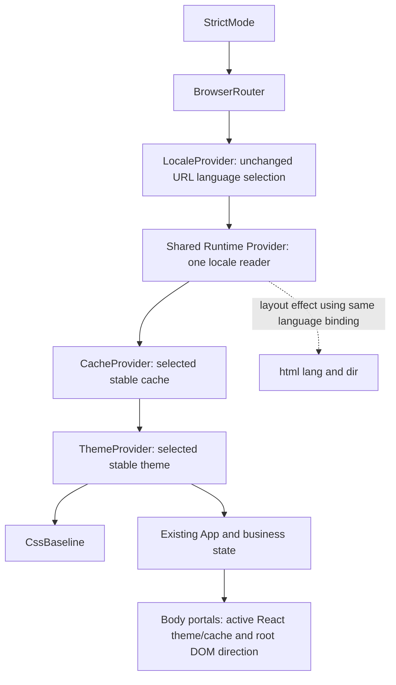

# Phase 4D.3 — Controlled runtime integration plan

Project: **Atlas Invoice — Migrating Enterprise React Apps to RTL Without Breaking LTR**. Planning date: 13 October 2026. Recommendation: **APPROVE WITH CONDITIONS for this plan; runtime implementation is not authorized by this document.** Preserve 4D runtime infrastructure → 4E component fixes → 4F controlled codemod expansion.

## Baseline and evidence authority

Verified branch `feat/phase-3-rtl-scanner`; HEAD `b65010b380f1659f5eef05bfc96a8f39d09ee89d`; initial working tree clean. Phase 4D.2 is committed, including the lexical-shadowing repair. Approved baseline: 186 scanner tests; 419 facts, 56 findings, 53 actionable, complete=true, nine nonblocking diagnostics. These counts describe the current source, not an acceptance target to force after runtime changes.

Primary evidence: phase-4c3-roadmap-review.md, phase-4d1-runtime-contract.md, phase-4d2-compatibility-review.md, phase-4a-implementation-roadmap.md, current entry points, locale/design-system sources, runtime-direction.ts, scanner policy and integration/policy tests, Playwright configuration and existing demo tests. Older documents retain checkpoint-specific limitations/counts. Stage 4D.2 supersedes 4D.1's statement that every CacheProvider is unresolved; it does not establish cross-file context flow or certify production layout.

**FACT** identifies inspected current source. **EXPERIMENT** identifies recorded isolated 4D.2 evidence, not fresh production proof. **PROPOSAL** is an unapplied decision. **GATE** requires explicit authorization or measured acceptance. No new compatibility experiments, dependencies, servers, worktrees, baselines or code are part of this planning stage.

## Current architecture

FACT: both main.tsx files compose StrictMode → shared Provider → BrowserRouter → LocaleProvider → App. Provider in libs/design-system/src/index.tsx exports one fixed LTR theme and renders ThemeProvider/CssBaseline. No production-owned Emotion cache or RTL processor exists.

FACT: libs/shared/src/i18n.tsx selects Arabic only for `demo=unmigrated-rtl&lang=ar`; otherwise English. It writes html lang/ar-EG or en and dir/rtl or ltr in useLayoutEffect. setLanguage changes search parameters while retaining pathname/hash; demoHref propagates them across routes and application links. Existing controls/notice are opt-in only. Locale selection is URL-derived, not an independent direction state.

FACT: design-system styles include plain CSS, MUI-generated styles and overrides, sx, and the Emotion SidebarFrame. SidebarFrame is a custom aside with fixed left:0, border-right and negative mobile translateX; styles.css separately reserves a left 238px gutter and resets it on mobile/print. Dialog and select menu portals are MUI-generated; React context crosses portals, while DOM direction normally comes from body/html. There is no general proof that all current portals are broken.

FACT: Provider-only unit/Storybook consumers use the default English locale context. The inspected consumers import Provider rather than the exported theme; retain the theme API nonetheless. App/form/filter/modal state is owned below the providers. Procurement has real select menus; a shared Modal consumer there is not established. Both apps' cross-links hardcode localhost:4200/4201.

## Proposed synchronized topology and direction contract

PROPOSAL: the design system owns generated-style runtime and document synchronization in one new `libs/design-system/src/runtime.tsx`. LocaleProvider retains selection, translation, navigation and context but relinquishes its document-writing effect. Both entry points reorder providers once to the topology above. Shared localization must not import the design system; existing design-system→shared dependency remains one-way.

The runtime component reads a single flat immutable binding `const { language } = useLocale()`. Use explicit matching `language === "ar" ? ... : ...` selectors for CacheProvider value, ThemeProvider theme and the same-file document dir assignment. Write document lang with the existing ar-EG/en mapping in a layout effect depending on language. Keep the document assignment literal-branch ternary, not `dir = direction`, which the existing rules cannot resolve. CacheProvider must have one direct ThemeProvider child; CssBaseline and children belong inside ThemeProvider. No wrapper/registry between these providers, spread props, imported cache constants or cross-file writer.

This is a proposed amendment to 4D.1 writer placement, resolving the 4D.2 activation gate without extending scanner rules. It does **not** prove the useLocale implementation or full cross-file provider reachability statically; source review, unit and browser tests establish that connection. A successful bounded proof is not full architecture certification.

Default English, opt-in English and invalid/Arabic-only queries remain en/ltr. Direct Arabic deep links resolve locale in the initial render, selecting RTL cache/theme immediately; the layout effect updates root attributes before committed React paint. Original English HTML remains unchanged; Arabic direction before JavaScript, SSR and error-shell first paint are outside this contract. Do not mutate document during render or introduce a new flag. Keep the existing notice wording pending a separate wording decision; it denotes an incomplete demonstration, not a claim that the runtime remains entirely unmigrated.

## Themes, caches, dependencies and insertion

PROPOSAL: module-lifetime, unexported `ltrCache` and `rtlCache`, created by the direct default @emotion/cache import. Literal options only:

- LTR: key `css`, stylisPlugins `[prefixer]`.
- RTL: key `atlas-rtl`, stylisPlugins `[prefixer, rtlPlugin]`.

Use direct imported prefixer from stylis and default plugin from @mui/stylis-plugin-rtl. Exactly one processor per pipeline. Keep CacheProvider mounted and change its value; never key providers or conditionally wrap the business subtree. Do not flush caches on a switch or recreate them per render. Caches are separate per application browser document, not shared between ports.

Keep the existing LTR theme values verbatim. Create a stable RTL theme with identical palette, typography, shape, defaults and overrides, changing only direction. Current analyzer requires direct createTheme calls with literal object options: an imported options object, root spread, dynamic direction or a createTheme(theme, overrides) pattern is not supported. Prefer two explicit literal option objects in runtime.tsx, with a focused comparison test ensuring equivalent options except direction; this deliberate duplication is bounded and must be reviewed. Export the literal LTR theme as `theme` directly from runtime.tsx and re-export it with Provider from index.tsx to retain public API. Do not introduce a separate local export-specifier alias of a selected theme without proving acceptance: escaping-definition analysis can reject it. Caches remain unexported. Verify this precise module with the real scanner before activation acceptance.

Required future direct exact dependencies: @emotion/cache 11.14.0, stylis 4.2.0, @mui/stylis-plugin-rtl 7.3.10. Existing resolved MUI 7.3.11, Emotion React 11.14.0/styled 11.14.1 and React/DOM 19.3.0 are the recorded fixture versions. Do not upgrade those packages or silently refresh unrelated transitive versions. Root manifest/lockfile changes require dependency approval and exact diff review.

EXPERIMENT: 4D.2 published registry/tarball evidence, prefixer/plugin order, noflip processing, and isolated Chromium dev/minified fixtures support this combination. Signature/provenance metadata was not independently cryptographically verified. The proof was not an actual Vite application build or full production acceptance. Revalidate real Vite dev/production output, first load, cascade and switching with the approved lockfile.

Use existing head append behavior; no prepend, injectFirst, new insertion point or parallel nested cache. Only the selected owned cache styles the production subtree. Assert ordinary controls receive the expected cache prefix. Warm both caches, then compare identical-state inventories after repeated cycles: no monotonically increasing tags/rules, duplicate active rules or inactive Global effects. Inactive component sheets may remain; CssBaseline/Global sheets may legitimately be replaced. Zero tag churn is not required. No direction-change cache.sheet.flush: retaining inserted maps after flushing can prevent reinsertion. Full HMR/multiple-root/SSR registry/disposal support is not proved and is outside this slice; document and investigate observed problems rather than invent a registry that the scanner cannot analyze.

## Shell and ownership boundary

PROPOSAL: preserve the left shell temporarily. In existing SidebarFrame only, place declaration-level `/* @noflip */` comments immediately before left:0, border-right, closed translateX(-100%) and open translateX(0). Protect the complete representative directional geometry; no plain-CSS conversion, sign change, anchor movement or right gutter. The zero transform is included for a complete documented contract. These are intentional processor exclusions, not semantic migration approvals or broad suppression.

EXPERIMENT: the isolated template preserved these declarations at 899/900/901px and print, in dev/minified processing. **GATE:** prove comments survive real Vite assembly, and sidebar anchor/border/motion/content gutter remain coordinated in both apps. If any piece flips, stop; do not activate a partly mirrored shell. Atomic shell migration requires separately approved scope in 4E (or an explicit roadmap amendment).

| Owner | Runtime treatment / exclusion |
| --- | --- |
| Plain styles.css and demo.css | Bypass Stylis; unchanged, including gutter/nav/KPI/chart geometry |
| Approved logical status/legend spacing | Preserve 6px/7px; no additional processing or physical override |
| MUI-generated styles, theme overrides, sx | Active theme plus one RTL pipeline; measure before manual correction |
| Custom SidebarFrame Emotion template | Explicit verified physical exclusions for shell only |
| React DOM inline style / SVG | Not transformed; no guessed geometry changes |
| Custom arrows, mixed tokens, branding | Preserve source; semantic remediation remains 4E |

Do not globally mirror SVGs or add a subtree LTR cache around the sidebar (that would also freeze generated descendants). No second RTL processor or hand-swapped generated declaration. Charts retain coordinates/data/chronology; plain Arabic label-flow problems remain. Runtime may alter Modal right:12 sx, fields, table defaults and pagination; remeasure rather than promise nine issues are fixed. Numeric/token alignment, caret policy, brand punctuation and chart labels need later semantic decisions.

## State, portals and switching

PROPOSAL: preserve all provider component types/positions during locale changes; App, routes, forms, filters and Modal remain unkeyed. Keep same-route search navigation; do not reset state in direction effects. Confirm translations can rerender without losing stored data. DataTable currently keys cells by translated labels: cell identities may change on translation; do not claim every descendant remains mounted, and do not fix these keys in this slice. Preserve business state and focus behavior with actual tests.

Normal Dialog/select-menu portals use the selected React theme/cache and global body direction. No new portal containers are necessary without evidence. Test switching with overlays open, focus trap/Escape/return, positioning and title/close clearance. Full-page cross-app navigation preserves query, not unsaved state transfer. Nested LTR identifiers retain current treatment; generated LTR widget islands would require matched local theme/cache/overlay direction and remain unsupported/out of scope here. No prospective tooltip bug is claimed.

## Scanner contract and policy prerequisites

The committed analyzer supports same-file direct imported caches/themes, literal options/plugins/keys and matching same-binding selectors. Lexical shadowing, nested/rest/array unsupported bindings, mismatches, duplicate keys, unknown factories/plugins, missing/reversed plugin order, mutable/escaping definitions, spreads, wrappers/aliases and unsupported cross-file flow must remain blocking `CACHE_CONFIGURATION_UNRESOLVED`; relevant uncertainty keeps complete=false/exit2. Do not rename providers, suppress diagnostics or weaken completeness to ship activation. Static analysis does not certify noflip, lifecycle, dependency integrity or actual layout.

FACT: moving theme declarations changes evidence source locations and finding IDs. index.tsx edits invalidate dynamicExceptions[2]'s whole-file source digest even if colors[status][0] is unchanged. Explicitly inspect the complete edited file and exact expression before proposing a new digest. The two Dashboard pins and two English HTML exceptions remain unchanged. No new semantic approvals; approvals and ownerOverrides stay empty. Relocated/removed runtime issue bindings may become unmatched informational warnings: propose precise associations or retain visible warnings for review, never infer visual resolution from association changes.

Expected live changes include removal/relocation of the fixed-LTR mismatch and cache-absence anchors, added literal theme/cache evidence and moved document evidence. Form/table/pagination/manual concerns remain independently reviewable. Exact fact counts, findings, diagnostics, IDs, locations and categories must be measured. Stable IDs of untouched anchors should remain stable. Do not require 419/56 after implementation or blindly update counts.

`tools/rtl-scanner/tests/policy.test.ts` currently compares live report against the archived report minus two pilot IDs, including source locations/policy digest/file inventory; `integration.test.ts` asserts current fact/diagnostic counts. These live assertions require a separately approved explicit expected-delta update after reviewing actual output. Keep independent archived JSON/Markdown hash assertions and historical meanings intact. No scanner production/model/schema/extraction changes are planned. If the proposed file cannot be proved under existing grammar, stop and request a bounded scanner prerequisite; do not silently expand implementation.

## Implementation sequence and approval gates

1. **Architecture gate:** approve writer consolidation, Provider reorder, literal duplicated theme options/API preservation, preserved-shell exclusions, unchanged opt-in mode/notice and single-root cache lifetime. If writer consolidation is rejected, stop and plan separately approved cross-file analysis; current split is not safe to certify.
2. **Dependency gate:** approve exact direct packages/lockfile scope. During authorized implementation, compare resolved versions to the proved fixture; stop on unexplained drift.
3. **Controlled patch:** add runtime.tsx; replace Provider/theme implementation with re-exports, reorder both mains, remove only obsolete document effect/import from LocaleProvider, add shell exclusions. No CSS/component semantic migrations. Validate standalone Provider consumers.
4. **Scanner/source-policy gate:** run real scanner before adjusting pins/assertions. Review unsupported diagnostics, relocated facts/IDs, index color-pin evidence and stale associations. Obtain approval for exact pin/issue binding and live expected-delta changes; no approval/suppression expansion.
5. **Verification gate:** add scoped runtime tests, execute matrix below in both actual dev and production applications; preserve all old English visuals/evidence. New Arabic captures belong in a separate 4D.3 evidence location after authorization; they are not replacements for the documentary before images.
6. **Closure gate:** review exact diff, dependency graph/lock, scan delta, measurements and test report. Stop after 4D.3 review; no automatic commit/push, 4E or codemods. Commit only after separately authorized closure.

Rollback proposal: record preconditions/digests and coherent provider/dependency/pin/live-test patch. Revert only the reviewed activation patch/commit, preserving unrelated work; do not reset/stash/discard. A failed test before closure means stop and report, not baseline refresh. Previous checkpoint can demonstrate Before without reverting the active working tree.

## Expected future file inventory

All paths are proposals, not changes made in this stage.

| Path | Bounded proposed change |
| --- | --- |
| apps/invoicing/src/main.tsx | Router/Locale/Provider reorder |
| apps/procurement/src/main.tsx | Same topology |
| libs/shared/src/i18n.tsx | Remove document synchronization effect; keep locale/navigation/translation contract |
| libs/design-system/src/runtime.tsx (new) | Literal stable themes/caches, locale reader, sole root writer, CacheProvider→ThemeProvider/CssBaseline |
| libs/design-system/src/index.tsx | Re-export Provider/theme; remove relocated implementations/imports; only approved SidebarFrame noflip comments |
| package.json / package-lock.json | Exact three direct runtime dependencies; no unrelated upgrades |
| rtl-scanner.config.json | Separately reviewed index source-pin refresh and necessary moved runtime issue associations only |
| tests/runtime-direction.test.tsx (new) | Actual Provider direction/state/default-context tests |
| tests/e2e/runtime-direction.spec.ts (new) | Both-app runtime, repeated switching, shell/portal/spacing assertions |
| tools/rtl-scanner/tests/policy.test.ts | Explicit approved live delta; preserve historical hash/content assertions |
| tools/rtl-scanner/tests/integration.test.ts | Reviewed new live counts/coverage, retaining determinism/read-only checks |
| docs/phase-4d3-runtime-review.md (new) | Actual implementation evidence/results/deltas/limitations |
| docs/screenshots/phase-4d3/ (new, if authorized) | Separate after captures/manifest, never historical overwrite |

No expected changes to styles.css, Dashboard, business pages/data/formatters/translations, HTML roots, scanner production rules/model/schema/CLI, original baselines, archived Stage 3 reports or CI gates. Exact test filenames/evidence manifest may be finalized during scope approval, not silently expanded. If additional files are necessary, stop for review.

## Risk register

| Risk | Consequence | Mitigation / stop gate |
| --- | --- | --- |
| Writer split or wrong provider order | Root/theme/cache disagree | Single same-file writer; locale beneath Router; initial/reload/switch probes |
| Partial shell flip | Right sidebar with left reserved gutter or wrong mobile motion | Declaration exclusions; real Vite dev/prod at boundaries and print; stop on mismatch |
| New css cache changes precedence | English pixel regression | Existing append behavior; inspect CSSOM/order; zero-difference six goldens |
| Style/global accumulation | Stale styles or memory growth | Stable distinct caches, five warmed switch cycles, active Global checks; no per-switch flushing |
| Provider/remount/focus regression | Lost fields/filter/dialog state | Same types/unkeyed subtree; mount and business-value/focus assertions |
| Literal theme copies diverge | LTR/RTL differ beyond direction | Exact options comparison; preserve original LTR config/API |
| Changed source pins/tests hide drift | Incomplete scan incorrectly accepted | Explicit pin and expected-ID delta review; untouched historical assertions |
| Real bundler differs from isolated proof | Exclusions or plugin import fail | Actual production build/browser verification, no compatibility claim from fixture alone |
| Runtime improvement overclaimed | Chart/bidi/icons/branding remain broken | Separate generated changes from remaining 4E cases; no global mirroring |
| Multiple roots/HMR/SSR lifecycle | Duplicate caches or stale document state | Single production root contract; report observed development lifecycle issues; separate approval for registry/cleanup expansion |

## Required test matrix and measurable gates

Existing assertions, documentary evidence and proposed tests are distinct. The 68 Phase 2A images are history, not RTL correctness baselines. Existing six English goldens stay byte-identical with maxDiffPixels:0; never update them to accept activation.

| Area | Proposed execution / acceptance |
| --- | --- |
| English visuals/workflows | All six original English screenshot assertions and existing unit/e2e tests; both default English and opt-in English; no changed goldens/data/translations |
| Query semantics and initial loading | Both apps: default, invalid/lang-only, opt-in English/Arabic; fresh browser context and reload; invoicing /invoices/new,/customers,/settings and procurement /,/settings as actual routes; root lang/dir, active useTheme probe, actual generated class prefix/computed direction agree |
| Before-paint consistency | Instrument committed render/layout-effect and inspect real initial frame where feasible in StrictMode/dev and production; no document/theme/cache mismatch at committed paint; do not claim pre-JavaScript RTL |
| Repeated switches | Five English→Arabic→English cycles per app at 1440×1000 and 390×844; warm both caches first; same route/hash, preserve form inputs, invoice data, procurement filter, modal state and shell state; stable business mount count after StrictMode replay; no console/page errors |
| Style lifecycle | Inspect data-emotion keys and CSSOM (not textContent alone); active class prefix/physical generated field side follows direction; identical final warmed-state tag/rule inventories without duplicate active rules; inactive sheets allowed; no stale Global side effects |
| Shell | Both apps at 390,899,900,901,1440px; left anchor/gutter remain coordinated, mobile closed -238/open0 as measured fixture target, desktop gutter238; close/backdrop/focus/navigation interactions; print aside hidden/gutter reset |
| Forms and portals | Invoicing populated invoice form, empty/focus/error/notch states and select listbox; customer Modal/review Dialog open while switching; procurement status menu; actual theme/cache/root agreement, computed direction, focus/Escape/return and no value loss |
| Tables and pagination | Both real tables, headers/body/mobile scroll; invoicing Pagination next/previous data semantics; generated behavior measured, remaining per-column/token policy recorded for 4E |
| Logical pilot | Computed 6px status-dot and 7px chart-legend relationship remains correct in both directions/widths; no overlap or independently added mirror |
| Semantic residuals | Chart data/path order unchanged; no added SVG flips, token/branding changes or currency/date reformatting; record unresolved old issue families separately |
| Scanner/policy | Tool tests/typecheck/build; deterministic repeated JSON/MD; complete=true only with no relevant blockers; exact reviewed finding/diagnostic delta, source-pin validity and zero new semantic approvals |
| Protected evidence | Hash manifest six English images; all 68 documentary PNG bytes and archived Stage 3 hashes; retain old gallery/manifest; new after images separate |

Planned commands after implementation authorization: npm run rtl:scan:test; npm run rtl:scan:typecheck; npm run rtl:scan:build; npm run lint; npm run typecheck; npm run build; npm test; npm run test:e2e (no update-snapshots); compiled CLI JSON/Markdown scans to external temporary output. Existing application e2e suite has 20 tests; new tests add to it rather than replace/weaken it. Run real built apps in separately controlled verification sessions, preserving existing cross-app ports/origins. Unit tests alone cannot establish generated geometry, insertion or portal placement.

Use useTheme probes in tests/fixtures without permanent debug UI; generated-class/computed-style measurements and module/cache unit assertions together establish actual cache behavior. Never claim a DOM dir assertion alone proves selected plugin pipeline. Avoid artificial screenshot baselines for expected broken Arabic: reviewed targeted acceptance plus separately approved after visuals.

## Historical demonstration and remaining decisions

Retain original broken RTL checkpoint 61491d7f6dd359033c4a9e80b556d3b3e2446305, pre-pilot 05138f1c5f68db92bcd94afe11e63fd83322f8cb and current b65010b380f1659f5eef05bfc96a8f39d09ee89d as distinct comparisons. Future approved detached worktrees/browser contexts can isolate Before/After; hardcoded cross-app origins mean historical 4300/4301 manual cross-app links would jump to 4200/4201. Do not claim arbitrary-port cross-app navigation parity. Either manually navigate each historical origin in the video or separately approve a port-origin solution. No worktrees/servers are created now; historical screenshots are immutable.

Required human decisions: approve consolidated root writer/topology; exact dependency pins; theme/API representation; left-shell preservation and noflip scope; single-root cache lifecycle limits; source-pin/issue-binding and measured live-test delta review process; actual production verification sessions; separately stored after evidence. Preserve existing opt-in query/controls/notice unless wording changes are separately authorized. No claim of full Arabic support or complete nine-issue remediation.

If any required architecture cannot be represented and validated under these gates, activation remains **BLOCKED**, and the next action is bounded investigation rather than unsupported runtime rollout.

## Planning scope audit

Exact permitted change: `docs/phase-4d3-implementation-plan.md` only. No application, CSS, scanner, policy, dependency, tests, baseline or archived evidence changes. No runtime activation, installation, staging, commit, push, additional server/worktree or Phase 4E/4F work. This document is a proposal awaiting approval, not semantic permission or implementation authorization.

Fresh planning verification: 186 scanner tests passed; direct compiled scan retained 419 facts/56 findings/complete=true/nine nonblocking diagnostics and byte-identical JSON to the pre-runtime baseline. All 74 protected PNGs (six English plus 68 documentary) match the original Phase 2A checkpoint; both archived Stage 3 reports match HEAD. Git tracked/staged diffs are empty, and the only untracked file is this plan. git diff --check passes. Application build/browser tests and isolated compatibility installation were not rerun during planning; their future gates remain explicit above.
