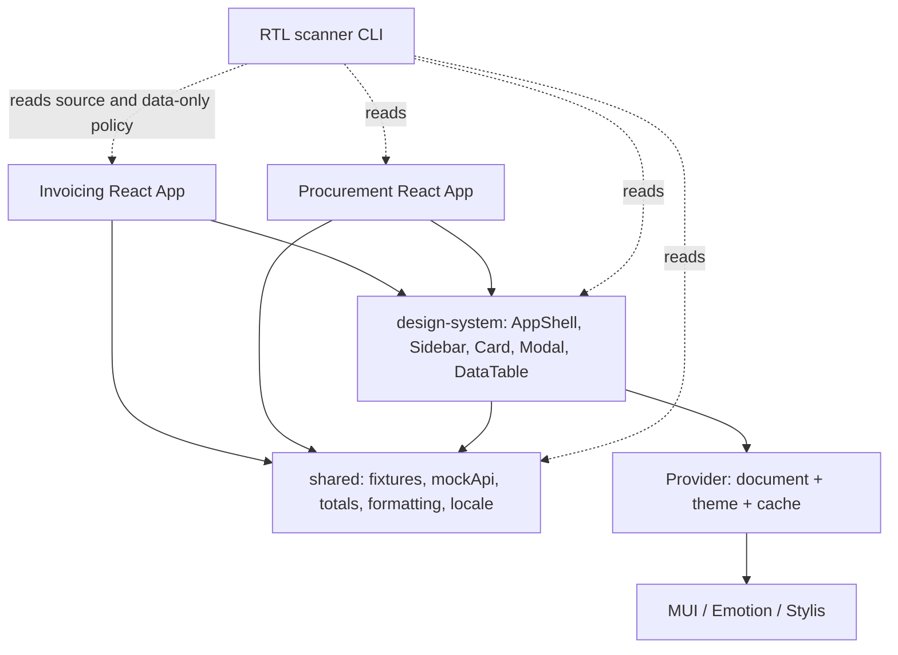
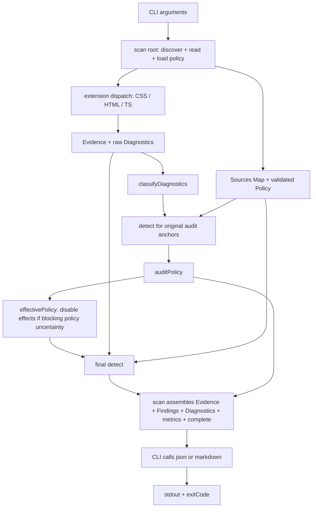
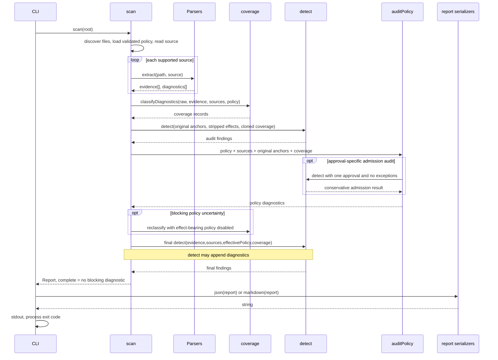

# Enterprise RTL Migration Lab — Technical Video Research

Research artifacts for **Coffee Break Web**, not a final script, narration, feature specification or production certification. Prepared 2026-10-23. Companion files: [Demo map](RTL_MIGRATION_DEMO_MAP.md), [Evidence index](RTL_MIGRATION_EVIDENCE_INDEX.md).

## 1. Executive summary

**Verified source baseline:** `FoushWare/enterprise-rtl-migration-lab`, default branch `main`, commit `b127325a14ad3bf8e70aede2a2e29b9dae638355`. Remote HEAD was checked and fetched during this investigation. The original feature checkout and all video assets were preserved. Research used the separate latest worktree; its pre-existing `nx.json` analytics/formatting edit is unrelated and excluded from this PR. Committed Nx configuration, not that edit, grounds the architecture claims.

Status vocabulary used throughout:

- **IMPLEMENTED / verified:** source exists and was inspected; runtime verification is stated separately.
- **PARTIALLY IMPLEMENTED:** bounded support exists; broader capability is not established.
- **PROPOSED:** an engineering recommendation, not current repository behavior.
- **NOT SUPPORTED:** absent from the inspected implementation, within the stated scope.
- **UNVERIFIED:** not demonstrated by current execution/evidence.

Important results from fresh execution: **21 scanned files, one skipped file, 440 Evidence records, 42 Findings, nine non-blocking Diagnostics, `complete=true`**. Findings: 36 `MANUAL_REVIEW`, three `RUNTIME_CONFIG`, two `INTENTIONAL_LTR`, one `INFORMATIONAL`; **zero production `AUTO_CANDIDATE`**. The 39 “actionable” count means excluding informational/intentional categories, not 39 confirmed visual defects. JSON was byte-identical on a repeated scan. Existing tests rerun: 186 scanner, 24 codemod, nine app unit tests passed. Browser test results and limits are recorded in §12/§15. [E12–E25](RTL_MIGRATION_EVIDENCE_INDEX.md#e12)

The strongest story is **preserving meaning while changing presentation**: two apps share styling/runtime infrastructure; a static scanner records risks and uncertainty; policy constrains automation; charts preserve a reviewed timeline; real browser tests check both directions. This is a fictional B2B demonstration, not proof of a real European company, production backend or commercial deployment. [E01–E11](RTL_MIGRATION_EVIDENCE_INDEX.md#e01)

The published [Architecture Explorer](https://foushware.github.io/enterprise-rtl-migration-lab/architecture-explorer.html) was fetched successfully. Its embedded `projectStory.revision` is **`8041f4c9c4411adb0247c3061727086c9d0735b7`**, older than this research. It is useful as historical teaching material, **not the authority for current codemod/runtime/CI capabilities**. [E48](RTL_MIGRATION_EVIDENCE_INDEX.md#e48)

## 2. Repository architecture — Investigation A

### System boundary and dependencies

**IMPLEMENTED:** Nx monorepo, React/Vite apps `invoicing` and `procurement`, libraries `design-system` and `shared`. Project JSON identifies source roots; `tsconfig.json` aliases `@atlas/design-system` and `@atlas/shared`. Nx is orchestration/configuration here, not a runtime service. Both app entry points wrap `BrowserRouter → LocaleProvider → Provider → App`. [E01–E04](RTL_MIGRATION_EVIDENCE_INDEX.md#e01)



This is a source dependency diagram, not a complete runtime dependency graph generated by Nx. The scanner's `applications: []` for library findings is path-based attribution; it does **not** imply no consumers. Source imports demonstrate both applications consume the library. [E04, E16](RTL_MIGRATION_EVIDENCE_INDEX.md#e04)

### Business and data flow

Invoicing implements overview, invoice list, invoice creation/detail, customers and settings routes. Procurement implements purchase-order list/detail and settings, with static order fixtures. Shared `mockApi` reads/writes browser `localStorage`; there is no demonstrated network backend, real billing integration, authentication or enterprise permissions system. [E02, E05](RTL_MIGRATION_EVIDENCE_INDEX.md#e02)

`INV-2026-1048` is generated at seed index zero: customer `c1` Northstar Studio, `Pending`, `USD`, invoice date `2026-10-10`, due `2026-10-20`, one item at quantity 1 × rate 4800. Flow: `seedInvoices → mockApi.listInvoices() → App` state → route props → `InvoiceTable` / `InvoiceDetails → total() → money()`. Saved localStorage takes precedence over seeds; recording in a fresh browser context avoids misleading seed expectations. `total` is arithmetic; `money` fixes display locale to `en-US`, independently of translated labels and document direction. [E05–E07](RTL_MIGRATION_EVIDENCE_INDEX.md#e05)

### Styling ownership inventory

| Mechanism | Actual owner/example | RTL responsibility and risk | Status/evidence |
|---|---|---|---|
| Plain CSS | `libs/design-system/src/styles.css`, imported by design-system | Browser applies logical/physical CSS; Emotion does not rewrite a loaded stylesheet | IMPLEMENTED [E08](RTL_MIGRATION_EVIDENCE_INDEX.md#e08) |
| React inline | Dashboard donut `style`, content styles | React CSS semantics; not automatically Stylis-processed | IMPLEMENTED [E09](RTL_MIGRATION_EVIDENCE_INDEX.md#e09) |
| MUI `sx` | StatusBadge, Modal IconButton, Sidebar ArrowForward | Theme/system values and Emotion pipeline; numeric spacing is not necessarily px | IMPLEMENTED [E10, E17](RTL_MIGRATION_EVIDENCE_INDEX.md#e10) |
| Emotion template | `SidebarFrame = styled.aside` | Uses logical placement and reviewed `@noflip` transforms; avoid a second manual mirror | IMPLEMENTED [E08, E10](RTL_MIGRATION_EVIDENCE_INDEX.md#e08) |
| MUI theme overrides | `runtime.tsx`, MuiButton/MuiTableCell | Theme defines component configuration; theme.direction alone does not rewrite every style source | IMPLEMENTED [E11](RTL_MIGRATION_EVIDENCE_INDEX.md#e11) |
| Generated style processing | stable `css` and `atlas-rtl` caches | Explicit prefixer, RTL plugin only in RTL cache; ownership is a configuration contract | IMPLEMENTED [E11, E28](RTL_MIGRATION_EVIDENCE_INDEX.md#e11) |
| Icons / literals | MUI ArrowForward; translated `View all invoices →`; trend glyphs | Navigation progression differs from growth/external link meaning | IMPLEMENTED, semantic review required [E18, E35](RTL_MIGRATION_EVIDENCE_INDEX.md#e18) |
| SVG / branding | Dashboard hand-authored SVG; `.brand` composition | Geometry and chronology do not follow translated flex labels automatically | IMPLEMENTED [E09, E33, E34](RTL_MIGRATION_EVIDENCE_INDEX.md#e09) |

Current language is intentionally opt-in: only `demo=unmigrated-rtl&lang=ar` selects Arabic. `?lang=ar` alone stays English. The historical parameter/banner name is preserved even though current source includes RTL repairs; do not label current main as an untouched broken “before” state. Link construction preserves demo/language where applicable. [E06, E36](RTL_MIGRATION_EVIDENCE_INDEX.md#e06)

### Architectural risks and first files to open

A blind stylesheet change can affect both apps' shell/content reservation; a template change can interact with Stylis; editing numeric MUI spacing as px changes units; reversing a trend arrow changes meaning; flipping a chart path without its labels changes interpretation; language switches can remount/replace providers or lose form state if designed incorrectly. These are **inferred engineering failure scenarios grounded in real ownership boundaries**, not claims all are currently broken. [E08–E11, E28, E33–E37](RTL_MIGRATION_EVIDENCE_INDEX.md#e08)

Best visual source anchors: app `main.tsx` provider nesting; shared `index.ts` fixtures/money; design-system `SidebarFrame`, `.content` and `.app-link` rules; Dashboard SVG/labels; runtime cache selection; chart and forms tests. Begin by tracing a user journey, then follow the shared dependency before editing CSS.

## 3. Why a scanner / scanner architecture — Investigations B and C

### Scope and limitations

**IMPLEMENTED:** deterministic source inventory under Nx `apps/*/project.json` and `libs/*/project.json` sourceRoot, plus each app `index.html`; `.css`, `.ts`, `.tsx`, `.js`, `.jsx`, `.html`. Traversal sorts entries/files; excludes node_modules/dist/.nx/.git directories, symlinks, `.stories.tsx`; other suffixes are skipped. Relevant skipped stylesheet/JS-like files can create `SOURCE_COVERAGE` diagnostics. Current one skipped file is a story, not proof the entire repository was analyzed. Metadata sourceRoot is validated and parsed as JSON; no Nx plugin/config execution is needed for the scan. [E12](RTL_MIGRATION_EVIDENCE_INDEX.md#e12)

**NOT SUPPORTED as a universal guarantee:** arbitrary package roots, a complete transitive dependency graph, all CSS preprocessors, every JS evaluation/data-flow pattern, runtime pixels, focus order or production origin behavior. Missing/out-of-scope sources cannot be magically covered by `complete=true`. The flag is defined over reported blocking diagnostics within the implementation's discovery/analysis model, not universal semantic correctness. [E12, E17, E21, E28](RTL_MIGRATION_EVIDENCE_INDEX.md#e12)

The scanner reads code as data. It does not invoke `getDirection()`, mount React, evaluate application configuration or render a browser. AST/PostCSS are structural parsers; some heuristics still use regex over bounded properties, identifiers or source text. Do not claim “no regex” or complete compiler-level semantic proof. [E14–E18](RTL_MIGRATION_EVIDENCE_INDEX.md#e14)

**INFERRED design benefit:** a repeatable inventory and common classification language reduce inconsistent manual search, missed mechanisms and unreviewed automation. Manual investigation still owns semantics, rendering and UX. Large-enterprise scaling/performance beyond this small lab has not been benchmarked. Whole-repository safety and runtime correctness cannot be inferred from counts.

### Module-by-module responsibility

| Module / on-screen section | Input → output | Calls / important decisions | Why separated / consequence if absent |
|---|---|---|---|
| `cli.ts:1–9` | argv → formatted stdout + process exit | scan, json/markdown, exitCode; validates supported options | Entry/gate contract; without it consumers lose reproducible invocation |
| `scan.ts:11–34` | root → sorted files, sources, raw records | read Nx metadata, walk, loadPolicy, extension dispatch, ID normalization | Coordinates source scope; missing inventory silently changes meaning |
| `css.ts:4–15` | path/original/fragment/base → Evidence + Diagnostics | PostCSS, declaration walk, fact, range, valueParser | CSS syntax/location ownership; regex-only source replacement is unsafe |
| `html.ts:3–16` | HTML → root dir/lang facts + parser diagnostics | parse5, source locations, recursive walk | Captures initial markup; not client runtime direction |
| `typescript.ts:4–68` | TS/TSX/JS/JSX → style facts + uncertainty | TypeScript AST, import/const handling, sx aliases, extractCss for Emotion | Preserves mechanism/units; unsupported expressions remain explicit |
| `model.ts:2–15` | data contracts; text offsets → records/hashes | Point/Range/Evidence/Diagnostic/Finding/Report, hash, range, fact | Shared schema, traceability and stable IDs |
| `policy.ts:12–19` + `policy-validation.ts:22–108` | optional JSON → validated Policy or PolicyError | bounded data-only file, symlink/path/schema/duplicate/enum validation | Reject malformed authorization instead of treating it as trust |
| `coverage.ts:5–25` | raw diagnostics + facts + sources + policy → classified diagnostics | presentation whitelist and source-pinned exceptions; exitCode exported | Failure/uncertainty classification; absence can turn unknown into “safe” |
| `rules.ts:9–95` | Evidence, Sources, Policy, mutable Diagnostics → sorted Findings | evidence rules + direct TS AST; add; analyzeRuntimeDirection | Facts become conservative risks, with source/context/owner/treatment |
| `runtime-direction.ts:23–264` | TS SourceFile → scoped cache proofs/reasons | lexical bindings, cache/theme plugins/selection/topology/document correlation | Does not accept cache presence as sufficient proof |
| `policy-audit.ts:7–92` | original anchors + policy + coverage → policy Diagnostics | stale approvals/exceptions/overrides/IDs; may call detect per approval | Detect invalid reviewed records before effects are authorized |
| `scan.ts:35–48` | all records → schemaVersion 2 Report | audit detect, auditPolicy, effectivePolicy, final detect, metrics, complete | Reliability and risk counts remain separate |
| `report.ts:2–7` | Report → JSON / Markdown strings | escaping/group counts/fields; no HTML/file writer | Presentation stays independent of classification |

Verified symbols/line links: [E13–E23](RTL_MIGRATION_EVIDENCE_INDEX.md#e13). Responsibilities explain current code; “why separated” is architectural interpretation, not a quotation of an undocumented author decision.

### Actual control/data-flow diagram



The graph omits the conditional reclassification branch for visual clarity: if effective policy changes, scan reclassifies raw diagnostics with effects disabled before final detect. `auditPolicy` can itself invoke `detect` for each approval; therefore there are **two main orchestration passes, not necessarily exactly two total detect calls**. Diagnostics can be added by parsers, policy auditing and detection; they are not an independent linear “stage after Findings.” [E19–E21](RTL_MIGRATION_EVIDENCE_INDEX.md#e19)



## 4. Verified data flow — Investigation D

### Primary real example: shared chart gutter

Source [styles.css:287–296](../../libs/design-system/src/styles.css#L287-L296):

```css
.chart-labels {
  display: flex;
  justify-content: space-between;
  padding-left: 40px;
  font-size: 9px;
  color: #949cad;
}
```

This is an actual shared stylesheet declaration, not the illustrative `.btn {margin-left:20px}` diagram. The `.chart-wrap` is intentionally LTR and the physical gutter aligns fixed SVG axis geometry; current browser contract preserves 40px. A finding here is valuable precisely because the correct action is **review, not blindly convert**. [E08, E24, E33](RTL_MIGRATION_EVIDENCE_INDEX.md#e24)

| Step | Actual input / transformation | Actual output / engineering meaning |
|---|---|---|
| Discovery | libs/design-system project sourceRoot + walk | styles.css enters files; both app imports matter even though library Finding applications is [] |
| Read | original stylesheet string in sources Map | source bytes available for exact ranges, fingerprints and audit |
| Parser | extractCss(path, text); PostCSS declaration walk | property padding-left, value 40px, context stylesheet/.chart-labels |
| Evidence | fact(...), then scan normalizes semantic ID with occurrence ordinal | ID `8836248fe0ff21d6599cbf1b4e4133088b157eab84c9dc123a9a1fd8a88b31ce`, line 290 column 3, exclusive end offset 4658 |
| Ownership | policy ownership.css | custom-css; owner alone does not establish reading-start meaning |
| Rule | physical horizontal branch, rules.ts:27–31 | exact approval missing; safe condition false |
| Policy audit | approvals empty; binding associates this anchor with RTL-02 | issue binding is traceability, not approval or calibrated defect coverage |
| Finding | final detect + add | MANUAL_REVIEW / Minor / High, suggestion null |
| Diagnostics | full repository scan retains nine nonblocking records | no blocking diagnostic attributable to this fixed declaration; other uncertainty remains recorded |
| Completeness | no final blocking diagnostic | complete=true under supported scan scope, not proof of chart correctness |
| Report | json()/markdown() | includes record, treatment/limits, evidence link and metrics |

Actual Finding from the fresh run (unmodified JSON fields):

```json
{
  "id": "RTL.CSS.PHYSICAL:82212e990854fbb975d34448",
  "ruleId": "RTL.CSS.PHYSICAL",
  "ruleVersion": 1,
  "category": "MANUAL_REVIEW",
  "severity": "Minor",
  "confidence": "High",
  "title": "Physical horizontal declaration",
  "sourceMechanism": "css",
  "applications": [],
  "path": "libs/design-system/src/styles.css",
  "range": {
    "start": {
      "offset": 4639,
      "line": 290,
      "column": 3
    },
    "end": {
      "offset": 4658,
      "line": 290,
      "column": 22
    }
  },
  "original": "padding-left: 40px;",
  "context": "stylesheet/.chart-labels",
  "ownership": "custom-css",
  "rationale": "Physical syntax does not establish reading-start/end intent or styling ownership.",
  "treatment": "Review semantics, writing mode, cascade and owner before any conversion.",
  "evidenceIds": [
    "8836248fe0ff21d6599cbf1b4e4133088b157eab84c9dc123a9a1fd8a88b31ce"
  ],
  "relatedLocations": [],
  "issueIds": [
    "RTL-02"
  ],
  "suggestion": null,
  "limitation": "Static evidence indicates a risk; rendered behavior is not established by this scan."
}
```

Field interpretation:

- `id`, `ruleId`, `ruleVersion`: distinguish this semantic occurrence from the rule family; not a universal source-independent identifier.
- `path`, `range`, `original`, `context`: let the reviewer find and validate the exact source. End offsets are exclusive; line/column are human navigation aids.
- `category`, `severity`, `confidence`: treatment bucket, impact priority and confidence are separate axes. High confidence in a physical-syntax risk does not mean proven visual failure.
- `sourceMechanism`, `ownership`: identify which pipeline owns the declaration. `applications:[]` is not dependency analysis.
- `rationale`, `treatment`: explain why static evidence cannot authorize conversion and what to inspect next.
- `evidenceIds`, `relatedLocations`, `issueIds`: provenance and cross-reference, not additional approvals.
- `suggestion:null`: no admitted automatic candidate; do not synthesize a patch from the property name.
- `limitation`: runtime rendering has not been established by this static record.

### Secondary example: unresolved runtime theme direction

**Verified existing test fixture**, [detection.test.ts:35](../../tools/rtl-scanner/tests/detection.test.ts#L35), not production runtime:

```ts
import {createTheme} from "@mui/material";
createTheme({direction:getDirection()});
```

The parser returns `evidence:[]`, `diagnostics:[]` for this exact fixture. `detect()` directly inspects the createTheme call/import and its direction initializer. `!ts.isStringLiteral(p.initializer)` is true for the call expression. It does not invoke the function. It separately pushes a blocking `RUNTIME_DIRECTION_UNKNOWN` Diagnostic (`DIRECTIONAL_UNSUPPORTED`) and adds an `RTL.RUNTIME.DIRECTION_UNKNOWN` Finding (`RUNTIME_CONFIG`, Minor, Low confidence, suggestion:null, evidenceIds:[]). This is **not** a generic conversion of every Diagnostic into a Finding. [E26](RTL_MIGRATION_EVIDENCE_INDEX.md#e26)

This fixture demonstrates uncertainty that the real chart gutter cannot: a scan with such blocking uncertainty would be incomplete even if other rules found no risks. Avoid inserting this fixture into protected application source just to record it; run the existing test or a separate temporary harness.

## 5. Rules and policy analysis — Investigation E

### Contracts and ownership

Evidence is an extracted fact with mechanism, context, source range and original value. A Finding records a risk/classification/treatment. A Diagnostic records a parser/source/configuration limitation and may be blocking. A rule here is executable logic in `detect()` plus the supported rule-ID catalog, **not a universal exported Rule object DSL**. Policy is validated data with source-bound approvals, exceptions, ownership, roles and issue bindings. [E14, E16, E18, E20](RTL_MIGRATION_EVIDENCE_INDEX.md#e14)

Ownership precedence in evidence detection: compatible scoped `ownerOverrides` → mechanism ownership → `unknown`. Conflicting owners are reported as `RTL.OWNERSHIP.CONFLICT` in direct detection; strict policy validation also rejects conflicting duplicate overrides rather than silently trusting one. Unknown or conflicting ownership does not authorize automation. `generatedStyleOwner` describes generated runtime styles; it does not prove every source property is already correctly handled. [E18, E20, E27](RTL_MIGRATION_EVIDENCE_INDEX.md#e18)

### Category matrix

| Category | Actual route / conditions | Example and engineering action | Limit |
|---|---|---|---|
| AUTO_CANDIDATE | physical-property branch meets every conservative admission condition | approved test fixture margin-left:2px → suggestion margin-inline-start:2px; inspect plan then validate | No production candidates now; not automatic application |
| MANUAL_REVIEW | unresolved semantics/geometry/ownership or other review rule | real chart padding-left; assess chronology/gutter/owner | Not synonymous with a bug |
| RUNTIME_CONFIG | locale, theme/cache/document, generated controls needing runtime review | money fixed locale; TextField; dynamic theme fixture | Scoped static inference; not a live browser verdict |
| INTENTIONAL_LTR | exact exception category in reviewed policy | initial English index.html direction exceptions | Whole application is not exempted; anchor must remain valid |
| INFORMATIONAL | explicit source-information rules or allowed informational exception | document RTL assignment fact | Not an issue gate by itself; not permission to ignore associated risks |

Current output has 36/3/2/1 for manual/runtime/intentional/informational and zero auto candidates. [E16, E18, E24–E27](RTL_MIGRATION_EVIDENCE_INDEX.md#e16)

Approvals include path/context/property/value/owner/logicalProperty/reason/reviewedBy/whole-file sourceDigest. Exceptions bind rule/path/context/originalDigest with category/reason/reviewer. Dynamic exceptions bind a supported background expression/valueDigest and whole sourceDigest; they do not execute the expression. Issue bindings attach RTL-01…RTL-09 references; they do not authorize suppression. Brand roles are metadata for a specific rule. [E20, E27](RTL_MIGRATION_EVIDENCE_INDEX.md#e20)

Stale or nonunique approval, changed source digest, invalid owner/mapping or unsupported evidence produces blocking policy diagnostics. Blocking policy uncertainty disables approvals, exceptions, dynamicExceptions and ownerOverrides for final effects, and reclassifies raw diagnostics. Certain unmatched informational associations are warnings rather than blocking authorization errors. [E19–E21](RTL_MIGRATION_EVIDENCE_INDEX.md#e19)

## 6. AUTO_CANDIDATE deep dive

**Exact scanner predicate**, [rules.ts:28–31](../../tools/rtl-scanner/src/rules.ts#L28-L31), read together with policy auditing:

1. An approval exactly matches path, context, original property, original value, resolved owner and current whole-file SHA-256.
2. Approved logical property normalizes to the branch's expected left→inline-start / right→inline-end form.
3. No extracted writing-mode anywhere is different from horizontal-tb.
4. Mechanism is not `mui-sx`.
5. Value is not inherit/initial/unset/revert/revert-layer, contains no lowercase `var(`/`env(` match, and the declaration is not covered by a blocking dynamic diagnostic.
6. Resolved owner is custom-css, custom-inline or custom-emotion-logical.
7. Property belongs to the supported physical margin/padding/border family; other physical review branches do not become candidates merely by having approval.
8. No blocking diagnostic exists in the passed diagnostic collection.
9. No other peer evidence has the same normalized property in this context.
10. No peer `position` evidence exists, and no peer writing-mode/direction evidence exists.
11. Policy audit must independently admit a unique supported approval and reject conflicts/staleness, including an approval and exception on the same declaration.

These conditions are deliberately conservative and sometimes broad (global writing-mode/diagnostics). They do not prove all CSS cascade equivalences. The scanner does **not** categorically reject every function-shaped string in this predicate: the downstream codemod has stricter function/value/cascade guards. Nor does “not mui-sx” mean the scanner automatically admits every other mechanism. [E18–E20, E29](RTL_MIGRATION_EVIDENCE_INDEX.md#e18)

The currently tracked policy has `approvals:[]`; the production dry-run has empty eligibleIds, selectedIds and files. A fresh direct fixture using an explicit whole-file approval reproduced `AUTO_CANDIDATE` with `{property:"margin-inline-start",value:"2px"}`. This is a **test-fixture result**, not approval to change a production declaration. Existing foundation/policy/codemod tests verify accepted and rejected cases. [E25, E29, E30](RTL_MIGRATION_EVIDENCE_INDEX.md#e25)

Distinguish four events: (a) detected risk → (b) conditional suggestion → (c) explicit reviewed source-pinned authorization → (d) a separately invoked write operation. They can be related, but none is interchangeable with the others. In this implementation approval is a prerequisite for the auto candidate, not an automatic effect of discovering a declaration.

## 7. Codemod and automation assessment — Investigation F

**IMPLEMENTED:** `tools/rtl-codemod/codemod.mjs` exports prepare/apply/rollback; CLI defaults to dry-run and accepts explicit operations. This is a separate tool from the read-only scanner. Existing tests include real transformations in temporary Git fixtures. Do not describe codemods as wholly hypothetical. [E29–E32](RTL_MIGRATION_EVIDENCE_INDEX.md#e29)

`prepare()` rescans; requires complete analysis; selects explicit unique finding IDs admitted as plain CSS/custom-css candidates; confirms a single evidence link and suggestion. It rejects function-like values, dangerous CSS-wide values, protected dynamic source pins, logical/shorthand collisions, file direction/writing-mode islands, stale source spans, missing exact approvals and partial-file selection that would stale remaining approvals. Plan includes HEAD, input/policy digests, original and proposed bytes/hashes/edits. With no explicit selection, no files change even when fixture candidates exist.

`apply()` requires clean committed checkout; validates exact plan shape, recomputes and compares the full plan, checks committed provenance, writes an exclusive restricted external journal, fsyncs it, stages output files, rechecks source, then renames. It consumes only selected existing approvals and rescans after apply; policy/coverage failure triggers recovery. It does not stage, commit, push or grant new approvals. Rollback requires the plan's original commit at HEAD; after committing a migration it is not a generic post-commit undo command. `rollback()` checks journal/provenance/current bytes, restores only untouched matching postimages and is idempotent for already restored members. [E29–E32](RTL_MIGRATION_EVIDENCE_INDEX.md#e29)

**PARTIALLY IMPLEMENTED safety boundary:** staged multi-file replacement and ordinary I/O recovery are present, but replacement is **not crash-atomic across files**. A process interruption can leave mixed versions; journal-assisted rollback is needed. Concurrent user edits are refused rather than overwritten. No universal TS/JSX/MUI/Emotion/geometry/icon/chart codemod exists here. There is a byte-exact proposed before/after plan; no need to claim a dedicated unified-diff generator. [E31](RTL_MIGRATION_EVIDENCE_INDEX.md#e31)

**PROPOSED engineering workflow:** semantic review → exact source-bound approval → narrow dry-run selection → human diff → isolated apply with durable journal → scanner/protection/unit/RTL/LTR checks → review/commit → retain journal until accepted. Never run mass left/right replacement. Changed HEAD/source/policy invalidates the reviewed plan; do not update fingerprints merely to make it pass. This investigation ran dry-run and existing fixture tests only; it did not apply/rollback on the real apps.

## 8. Revenue chart / business semantics — Investigation G

**IMPLEMENTED real visual:** Dashboard hand-authored SVG revenue curve, axis labels, six HTML month labels, legend and accessible description; payment-status donut uses real invoice counts. No chart library is imported in this component. Revenue trend paths and comparison notes are explicitly illustrative; they are not a backend-derived revenue time series. KPI paid/pending/overdue totals filter to USD, while counts include all currencies. [E09, E33](RTL_MIGRATION_EVIDENCE_INDEX.md#e09)

The implemented local contract keeps `.chart-wrap` LTR, the label axis LTR and the 40px physical gutter; Arabic month text is locally RTL and isolated. Tests compare SVG paths, ticks, endpoint, gradient, transform matrix, label positions, donut colors/counts, breakpoints and print behavior across switches. Current labels remain chronological May→October left-to-right. [E08, E33](RTL_MIGRATION_EVIDENCE_INDEX.md#e33)

| Business question | Evidence-supported answer / recommendation |
|---|---|
| Must every RTL chart mirror? | No. This chart intentionally preserves its axis. Universal policy is not established. |
| When retain LTR? | For a reviewed shared axis/time-series convention or cross-language comparability; actual lab contract does this. Product decision, not a CSS theorem. |
| When permit RTL presentation? | If users/UX choose an RTL chronology and **data, coordinates, ticks, labels, interactions and description** change coherently; PROPOSED alternate design, not implemented here. |
| Labels / legends | Translate human labels without detaching labels from geometry/category/color. Existing month/legend/donut tests provide concrete examples. |
| Tooltips | No interactive chart tooltip implementation was found in Dashboard. Localization/order/keyboard/touch behavior would be PROPOSED future work, not a demo of existing capability. |
| Numbers / currency | Current money() is en-US currency formatting; axis ticks are literal $…k text. Arabic digits/grouping/currency-display policy requires Product/Finance/localization review. Never mutate canonical currency/amount data just to change presentation. |
| Mixed Arabic/English | Isolate numeric/token runs and let human labels use appropriate text direction. Tests measure glyph ordering; “set everything LTR” is not acceptable. |
| Decision owner | PROPOSED: Product/UX owns reading convention, Finance validates interpretation, design-system/chart owner implements, localization/accessibility review language and interaction. |
| Static scanner role | Report SVG/flex correspondence risk; it cannot choose the correct business chronology or certify visual meaning. |
| Policy record | Document source/context, axis intent, gutter/labels, reviewed owner/reviewer and expected browser contract; do not invent a current chart-specific approval schema. |

Concrete honest recording: open current Dashboard Arabic; inspect last label October and endpoint, show CSS axis contract and actual chart test assertions; switch English→Arabic→English. Explain a hypothetical bad mirror with an explicitly labelled conceptual overlay, not by claiming current main is broken or editing protected source. Incorrect chronology can make revenue appear to decline or attach the wrong period to a data point. That consequence is an engineering scenario, not a detected current financial error.

## 9. MUI and Emotion analysis — Investigation H

**IMPLEMENTED:** stable module-level LTR/RTL themes and private caches; public English theme identity preserved; LTR cache key `css` with `[prefixer]`; RTL `atlas-rtl` with `[prefixer, rtlPlugin]`. Provider uses the same language predicate for document.lang/dir, selected cache and selected theme. useLayoutEffect updates document root. LocaleProvider and Provider remain mounted while route query changes. [E06, E11, E28, E37](RTL_MIGRATION_EVIDENCE_INDEX.md#e06)

Generated MUI/Emotion styles pass through the selected cache pipeline; plain stylesheet and React style attributes do not become Stylis input. Logical CSS is not a reason to reflect every transform. SidebarFrame uses `@noflip` for explicitly controlled mobile translateX states. `.app-link` CSS mirrors the reviewed navigation SVG once in RTL; trend/external arrows have different semantics. A manual geometry patch plus RTL processing can double-flip physical intent; this is a plausible ownership failure, not a claim all existing styles flip twice. [E08, E10, E35](RTL_MIGRATION_EVIDENCE_INDEX.md#e08)

`analyzeRuntimeDirection` supports a narrow static grammar: directly bound imports, module const caches/themes, explicit key/plugin arrays, compatible nested providers, literal/immutable conditional selection, matched document selection and lexical binding, correct plugin order/distinct cache keys; escaping/mutable/render-local caches, unresolved wrappers or predicates and duplicate processors become reasons to reject support. Existing negative fixtures exercise these. **Static acceptance is not proof of runtime lifecycle, portal geometry or every MUI component.** [E28, E37](RTL_MIGRATION_EVIDENCE_INDEX.md#e28)

Current browser tests verify switching preserves entered form state, filters/pagination, canonical invoice data, dialog containment/focus return, root/portal direction and chart geometry. They do not establish all assistive technologies, all browsers or arbitrary external wrappers. Recommended architecture expansion should remain separate from this implemented subset. [E36–E40](RTL_MIGRATION_EVIDENCE_INDEX.md#e36)

## 10. Reporting, diagnostics and coverage — Investigation I

Report schema 2 contains files/skipped, Evidence, final Findings, classified/appended Diagnostics, input/policy digests, metrics and complete. JSON is pretty-printed serialization with newline; Markdown includes summary category counts, finding sections, coverage diagnostics and source evidence table. Findings sort by path/source offset/rule ID; category/severity/confidence counts do not imply calibrated risk weights. `uniqueAffectedFiles` and `referenceCaseIds` are sets, not dependency or completeness percentages. [E16, E19, E22, E23](RTL_MIGRATION_EVIDENCE_INDEX.md#e16)

Fresh JSON summary:

```json
{"files":21,"evidence":440,"findings":42,"diagnostics":9,"complete":true,
 "byCategory":{"INFORMATIONAL":1,"INTENTIONAL_LTR":2,"MANUAL_REVIEW":36,"RUNTIME_CONFIG":3}}
```

Actual Markdown prefix:

```markdown
# Conservative RTL risk report

Static risks and documented exceptions, not automatic proof of visual failures.

Schema: 2; files: 21; extracted facts: 440; findings: 42; diagnostics: 9; complete: true.
```

Blocking defaults apply to unresolved directional/source conditions. Parse/coverage failures become SOURCE_FAILURE. Dynamic presentation keys such as color/fontSize can be NONBLOCKING_DYNAMIC; a narrowly supported source/value-pinned background exception can also be nonblocking. Unknown sx ownership is nonblocking only for a fully literal whitelisted presentation object. Runtime direction/cache uncertainty can append explicit blocking diagnostics later in detection. Invalid policy can throw PolicyError and CLI exits 2 rather than always yielding a full report. [E20, E21, E26, E28](RTL_MIGRATION_EVIDENCE_INDEX.md#e20)

Exit contract: incomplete → 2; otherwise `--fail-on-findings` with non-INFORMATIONAL/non-INTENTIONAL_LTR findings → 1; otherwise 0. Fresh ordinary CLI exit 0 despite 39 actionable risks; fresh gated CLI exit 1. Existing tests cover incomplete exit 2. Zero findings never cancels a blocking diagnostic. No coverage-percentage denominator exists. [E13, E21, E25](RTL_MIGRATION_EVIDENCE_INDEX.md#e13)

**IMPLEMENTED CI:** workflow runs scanner build/types/tests/scan and codemod tests/dry-run, protection checks, build/app tests, dev and production Playwright. It invokes scan without --fail-on-findings, so its scan step gates incompleteness, not every remaining risk. **PROPOSED backlog use:** group findings by owner/category/context and related issue; require human risk triage and preserve fingerprints. No verified issue-tracker synchronization, Jira integration, GitHub issue creation or automatic backlog writer was found. [E41](RTL_MIGRATION_EVIDENCE_INDEX.md#e41)

## 11. Implementation strategy — Investigation J

Recommendations, informed by the implementations below; not a claim a new migration was performed during research:

1. Preserve business contract first: invoice IDs/status/currency/amount/date storage, route behavior and persistence. Translate labels, not business values. Shared data and browser tests are the invariants.
2. Establish ownership and source scope. Review shared shell before app-local polish because two apps consume it. Do not infer no impact from applications:[].
3. Synchronize document/theme/cache before patching generated MUI internals. Use real runtime.tsx as the bounded implemented example.
4. Review logical properties for normal reading-start/end spacing, e.g. SidebarFrame border/inset and paired content reservation. Positional geometry/mobile transforms need coordinated review.
5. Keep intentional islands narrow: brand composition, numeric tokens and this chart's chronology are distinct reasons, not a global LTR wrapper for all Arabic text.
6. Review icons by semantics: navigation, trend and external-link cues differ. Current scoped navigation tests prevent collateral reflection.
7. Use the codemod only for explicit admitted plain CSS candidates. Current zero-candidate production state means the honest live demo is a no-op plan plus existing fixture tests, not a fabricated production patch.
8. After each bounded batch: review exact diff, rescan, verify policy/source pins, unit tests, relevant RTL geometry/state tests, English zero-diff baselines in a controlled environment, production preview, then approval.

Low-risk relative to geometry: a reviewed isolated declaration with known owner/no cascade conflict and passing checks. It is not intrinsically low-risk because its name contains left. Shared provider, shell geometry, chart interpretation, mixed bidi content and MUI unit conversions require deeper contextual review. Assign code ownership to the shared design-system team when both apps are affected, with product/localization/QA signoff for semantic decisions. Keep ADR-like review reasons, exact scope, test evidence and rollback plan; existing policy/review documents are examples, not a complete enterprise governance platform. [E08, E11, E27, E29–E42](RTL_MIGRATION_EVIDENCE_INDEX.md#e08)

## 12. Testing and validation — Investigation K

**Fresh verified:** scanner 186 tests (5 files), codemod 24 tests (one file), app unit 9 tests (two files), scanner compile to an external temporary directory (Node22.21.1/npm10.9.4), deterministic repeated JSON, real application scan and no-op codemod dry-run. Protection command verified **78 hashes**: six English baselines, 68 documentary screenshots, archived reports and pinned sources; exception records unchanged. [E25, E30, E42](RTL_MIGRATION_EVIDENCE_INDEX.md#e25)

Implemented browser suite includes baseline navigation/creation/filtering, six English screenshots at maxDiffPixels:0; Arabic opt-in/switch/navigation/persistence; chart, brand, KPI, bidi glyphs, directional arrows, forms/dialogs/tables, breakpoints, keyboard select/escape/tab trapping and focus return. It is not a blanket WCAG audit. No full axe/screen-reader certification was established. [E33–E41](RTL_MIGRATION_EVIDENCE_INDEX.md#e33)

**Fresh focused browser result:** four chart tests passed on installed Chrome155.0.8059.85, using a temporary external Playwright config and isolated port4300. They covered Arabic initial loads and en↔ar switching at 1440/390 widths, including geometry/donut/breakpoint/print assertions. The initial stock-config attempt stopped because port4200 was occupied; the existing server was preserved. No repository configuration, native preferences or screenshot baselines were changed. This is not a full browser-suite rerun.

Historical [delivery evidence](../autonomous/TEST_EVIDENCE.md) reports 108 dev and 108 production Playwright passes, six zero-diff English comparisons and final green CI receipts. Those are **recorded historical results**, not all freshly rerun for this documentation PR. The earlier native-date CI mismatch is addressed in current CI with hosted-only AppleLocale preparation/restoration, documented causal evidence and unchanged snapshots. Do not present it as a still-unresolved current blocker or run defaults writes on a developer machine. [E41, E43](RTL_MIGRATION_EVIDENCE_INDEX.md#e41)

| Validation area | Implemented evidence | Recommended release matrix / remaining limit |
|---|---|---|
| English LTR pixels | baseline.spec six images, maxDiffPixels:0 | Controlled browser/font/platform/region; no snapshot regeneration to hide changes |
| Arabic opt-in / round trip | demo, runtime, chart/forms tests | Initial load + repeated en→ar→en, reload, route query/state invariants |
| Shared shell | brand/sidebar/navigation geometry tests | Both apps, closed/open mobile, real hit areas and keyboard activation |
| Forms / portals | generated select/notch/labels/helper assertions, dialog geometry/focus | Mixed-language values, long labels, keyboard+touch, focus containment/order |
| Tables / navigation | canonical rows/filter/page preservation; direction and scroll checks | Numeric/token alignment policy still requires product decisions, not just current defaults |
| Charts | geometry/chronology/legend/donut/print tests | Data-label mapping, semantics and accessibility review; no tooltip demo invented |
| Bidi / tokens | DOM Range glyph measurements and copy/input invariants | Additional scripts, pasted punctuation, screen-reader pronunciation |
| Automation | positive/negative/adversarial codemod and policy tests | Diff, stale pins, no-op repeat, crash recovery, protected evidence |
| Runtime / build mode | dev and production preview configs | Real deployment origin, CSP, routing base paths, fonts and browser matrix remain unverified here |

**PROPOSED release blockers:** changed canonical business data, English pixel regression under the approved environment, unsupported blocking diagnostics, invalid policy, mismatched direction/cache/theme, keyboard/focus loss, chart semantic mismatch, changed protected evidence without authorization, red required checks. A static `complete=true` alone is not a release gate.

## 13. Engineering decisions and tradeoffs — Investigation L

| Problem / alternatives | Implemented choice and evidence | Tradeoff / failure scenario | Honest video demonstration |
|---|---|---|---|
| Locate cross-mechanism risks: manual grep vs source analysis vs browser-only | AST/PostCSS/parse5 + read-only source scan [E12–E18] | Bounded grammar and heuristics; not runtime truth | One declaration → fact → conservative finding, then browser contract |
| Decide semantics from syntax vs explicit human decision | reviewed, source-pinned approvals [E18–E20] | More review/no-op outcomes; prevents “left always start” | Production chart gutter stays manual despite High confidence |
| Apply policy silently vs audit authorization | schema validation + source audit + disabled unsafe effects [E20] | Strict/stale pins can block harmless-looking edits | Existing stale approval test and explanation of fingerprint scope |
| Treat all styles alike vs identify pipeline | mechanism + ownership + runtime proof [E17, E27, E28] | Less automation; avoids px/theme-unit and double processing mistakes | Compare plain CSS, sx spacing and cache selection |
| Hide uncertainty vs separate record types | Diagnostics + Findings + complete [E16, E21, E26] | Additional concepts; prevents quiet incomplete scans | getDirection fixture: explicit push and separate add |
| Recreate themes/caches on every render vs stable instances | module-level themes/caches [E11, E37] | Bounded static topology; unsupported wrappers require review | en→ar→en state retention, actual source and tests |
| Globally mirror layout vs preserve business islands | reviewed chart axis/brand/numeric isolation [E08, E33, E34, E38] | Per-component decisions and tests | SVG unchanged, translated Arabic labels, stable October endpoint |
| Mass replacement vs bounded source transformation | exact selected CSS property edits + journal [E29–E32] | Not crash-atomic or universal; more prerequisites | Fixture no-op/apply/rollback tests without production write |
| Count risks vs measure trust | complete derives from final blocking diagnostics [E19, E21] | Completeness limited to supported discovery; no percentage metric | Zero-findings fixture with blocking source uncertainty |
| Refresh images vs preserve prior behavior | zero-diff English + protected hashes [E39, E42] | Environment sensitivity, especially native controls | CI region investigation as test-environment lesson, not an application rewrite |

“Why” above is engineering interpretation supported by safeguards/tests, not invented claims about private author intent or measured commercial outcomes.

## 14. Best real examples — Investigation M

Ranks use 1–5 for educational value / depth / visual clarity / reproducibility / enterprise relevance; qualitative recommendations, not measured performance:

| Rank / demo | Scores | Exact anchors and actual behavior | Question / connection | Suggested time |
|---|---|---|---|---|
| 1 / D1 shared chart gutter + real Finding | 5/5/4/5/5 | styles.css:278–296; css.ts; rules.ts:27–31; actual record §4 | Why does a known CSS owner still require human judgment? Leads to chart semantics | 2:00 |
| 2 / D2 chart meaning | 5/5/5/4/5 | Dashboard.tsx:76–201; chart-direction.spec.ts | Why preserve this axis while translating labels? Leads to browser validation | 1:45 |
| 3 / D3 runtime direction + uncertainty fixture | 5/5/4/5/5 | runtime.tsx:80–92; detection.test.ts:35; rules.ts:52 | What can AST prove, and what still needs a browser? Leads to completeness | 2:00 |
| 4 / D4 controlled automation | 5/5/3/5/5 | codemod.mjs:82–121/175–211; codemod.test.mjs | What turns a risk into a reviewed write? Leads to checks/rollback | 1:30 |
| 5 / D5 English/Arabic regression | 5/4/5/4/5 | demo/forms/chart/baseline specs, runtime foundation | How do we prove presentation changed without data/state regressions? Closes release story | 1:45 |

Use INV-2026-1048 as the opening business thread (about one minute), not a sixth disconnected tooling chapter. Detailed commands, screenshots to capture, expected fields and blockers are in the [Demo map](RTL_MIGRATION_DEMO_MAP.md). No new screenshots or video were generated for this research.

## 15. Reproducible demo instructions and execution log

Run from a clean, dependency-prepared checkout of the researched SHA. No dependency installation was performed by this investigation. Building writes ignored dist output, not source.

```sh
npm run rtl:scan:build
npm run --silent rtl:scan -- --format json > /tmp/rtl-research-report.json
npm run --silent rtl:scan -- --format markdown > /tmp/rtl-research-report.md
npm run --silent rtl:scan -- --fail-on-findings > /tmp/rtl-research-gated.json
# Expected gated exit 1 at this baseline; ordinary scan exit 0.
npm run rtl:scan:test
npm run rtl:codemod:test
npm run rtl:codemod -- --dry-run
npm test
npm run rtl:verify:protected
```

Actual commands in this investigation:

| Command / action | Result and scope |
|---|---|
| gh repo view / git ls-remote --symref / git fetch origin --prune | default main; baseline b127325 unchanged; original branch not switched |
| tsc -p tools/rtl-scanner/tsconfig.json --outDir /private/tmp/rtl-video-research-build | passed; executable fresh modules compiled outside source checkout |
| fresh cli.js --root latest --format json twice, cmp | exit 0 twice; byte-identical output; summary §1 |
| npm run --silent rtl:scan -- --format json | exit 0; valid JSON parsed, 42 Findings |
| fresh cli.js --format markdown | exit 0; real prefix reproduced §10 |
| fresh cli.js --fail-on-findings | exit 1; expected risk gate, not an execution error |
| vitest --config tools/rtl-scanner/vitest.config.ts | 186/186 passed |
| vitest --config tools/rtl-codemod/vitest.config.ts | 24/24 passed; tests mutate only their temporary Git fixtures |
| vitest --config vitest.config.ts | 9/9 passed |
| codemod CLI --root latest --dry-run | exit 0; eligibleIds=[], selectedIds=[], files=[] |
| node scripts/verify-rtl-protections.mjs | passed; 78 hashes + exact exception records |
| isolated direct fixture harness from existing detection/foundation test inputs | approved CSS suggestion and runtime Diagnostic/Finding reproduced; no source writes |
| published Architecture Explorer fetch + JSON payload inspection | successful; historical revision 8041f4c, not current source authority |
| tracked-file SHA256 comparison against preserved pre-research baseline | unchanged, including original pending nx.json edit |

The freshly compiled scanner JS was compared byte-for-byte with the existing ignored dist scanner, allowing the existing codemod fixture suite to use its expected import path without rewriting source or rebuilding there. Temporary build, reports, fixture harness and logs remained outside the PR; exact values needed for review are embedded in these three Markdown files.

Before recording, regenerate reports instead of treating this document's counts as timeless. Never invoke codemod apply against protected production source for this demo. The only future mutation demonstration should be the existing isolated fixture test, with its identity clearly visible.

## 16. Connected engineering journey — Investigation N

This is a technical outline, not narration. Preserve the five agreed chapters; do not replace them with unrelated tutorials.

| Chapter / current problem | Engineering question / investigation | Evidence → decision / technique → result | New problem / transition |
|---|---|---|---|
| 1. Understand system: business asks Arabic | What user/data contract must stay stable? Trace invoice 1048 and mockApi | Source/data/route inspection → preserve canonical data and behavior → define invariants | Which shared owners can break both apps? |
| 1. Architecture discovery | Where do shell, locale, styling and providers live? | Imports + entry provider nesting → establish dependency/ownership map | We know owners, but not risk distribution |
| 2. Impact analysis | Which mechanisms contain directional syntax? | Deterministic scanner inventory → bounded facts + unresolved sources | Facts are not migration decisions |
| 2. Evidence extraction | What exactly did parser observe? | Real padding-left evidence/source range → inspect mechanism and context | Does left mean reading start or an axis gutter? |
| 3. Classification/risk | What can be safe under explicit policy? | detect + auditPolicy + ownership/digests → manual vs runtime vs admitted candidates | What is unknown, and can we trust silence? |
| 3. Completeness/report | Are there blocking analysis limits? | Diagnostics, complete, metrics/exit codes → backlog with trust boundaries | Which changes should we actually execute? |
| 4. Safe manual vs automated | Could exact reviewed plain CSS be changed safely? | Current no-op plan + existing codemod fixtures → understand clean/source/plan/journal preconditions | Bounded automation cannot choose business semantics |
| 4. Business semantics | Should this revenue timeline flip? | SVG/labels/accessibility + chart tests → preserve reviewed LTR axis, local Arabic text | Other owners need different fixes |
| 4. Runtime implementation | How do document/theme/cache and custom islands coexist? | runtime.tsx and scoped CSS/icon repairs → synchronize layers without double flips | How prove round-trip state and English are unchanged? |
| 5. Validation/release | Which failures block delivery? | Unit/geometry/focus/data/snapshots/protection/production preview → evidence-based readiness | Real deployment origin and product policy remain explicit signoff gates |

Suggested 12–15-minute allocation: business hook 0:45, architecture/data 1:45, detection/extraction 2:00, policy/uncertainty/report 2:30, automation 1:30, chart/runtime decisions 2:30, validation/limits 1:45; about 12:45 plus transitions. Extend rather than cram if exact approval conditions need more explanation. Final pacing and script require human approval.

## 17. Recruiter-relevant technical signals — Investigation O

| Signal | Concrete demonstration | Honest boundary / nonclaim |
|---|---|---|
| Architecture ownership | two apps share shell/runtime/locale/data; trace a cross-app change | A demonstrator, not proof of operating a real enterprise platform |
| React expertise | provider identity, controlled locale/query, state-preserving switches, route props, dialogs | No claim every React pattern or production concurrency case is covered |
| RTL experience | logical geometry, chart/brand/numeric islands, bidi glyphs, navigation semantics | Not “flip everything” and not universal Arabic UX expertise |
| MUI/Emotion knowledge | prefixer/RTL cache ordering, stable themes/caches, generated vs custom ownership | Static supported grammar does not prove arbitrary wrappers |
| Automation design | conservative candidate contracts, exact plan, no-op default, external journal | Narrow plain-CSS implementation; crash recovery is not multi-file atomicity |
| Static analysis | AST/PostCSS/parse5, fact/source identities, Diagnostics/Findings separation | Bounded analysis, not a compiler or visual bug oracle |
| Risk management | stale pin rejection, protected evidence, explicit incompleteness | No claim of a third-party security or compliance audit |
| Cross-team decision making | identify chart chronology/locale/accessibility signoffs to request | Proposed collaboration plan; no invented employer/project meetings |
| Testing strategy | source tests + browser geometry/state/focus + English zero-diff | No screen-reader/WCAG certification or all-browser proof |
| Enterprise-scale thinking | ownership, contracts, repeatability and rollback, scoped rollout | Scalability approach, not measured large-codebase operational performance |

Use phrases like “the lab demonstrates a safeguard” rather than “I migrated a real European finance company.” Source and receipts communicate technical depth without fictional work history.

## 18. Implemented vs proposed matrix

| Capability | Status | Evidence / limit |
|---|---|---|
| Nx React apps/shared components | IMPLEMENTED | E01–E07; mocked persistence, not real backend |
| Opt-in Arabic + document/theme/cache switching | IMPLEMENTED | E06/E11; grammar and browser tests are bounded |
| Source scanner with deterministic JSON/Markdown | IMPLEMENTED | E12–E25; scope apps/libs, no rendering |
| Approval/exception/pin audits | IMPLEMENTED | E20/E27; stale authorization fails closed |
| Generic automatic RTL fixer | NOT SUPPORTED | no universal rewrite path in scanner/codemod |
| Narrow plain-CSS prepare/apply/rollback | IMPLEMENTED | E29–E32; separate tool and explicit selection |
| Crash-atomic multi-file change | NOT SUPPORTED | journal-backed staged replacement/recovery instead |
| Production AUTO_CANDIDATE | NOT PRESENT at baseline | zero approvals/eligible IDs; fixture support verified |
| AST-based runtime configuration proof | PARTIALLY IMPLEMENTED | E28; direct scoped patterns, not arbitrary evaluation |
| Revenue chart | IMPLEMENTED | hand-authored illustrative SVG, real count donut; not real financial time series |
| Interactive chart tooltips | NOT SUPPORTED in inspected chart | product/accessibility design would be future work |
| Coverage percentage / HTML scanner report | NOT SUPPORTED | E19/E22/E23 |
| Scanner/codemod/visual gates in CI | IMPLEMENTED | E41; scanner invoked without fail-on-findings |
| Browser/a11y guarantees for all environments | UNVERIFIED | scoped Chrome/DOM tests; no general certification |
| Real deployed-origin verification | UNVERIFIED here | production preview differs from deployment |
| Backlog sync, universal chart convention, final localization policy | PROPOSED | recommendations require product/team decisions |
| Final video script/narration | NOT PRODUCED | this PR is research only |

## 19. Unanswered questions / human decisions

1. Which locale conventions should users see for money/digits/dates, separate from canonical values and Arabic language? Current en-US formatting is intentional source behavior, not final market research.
2. Is this chart's chronology and physical gutter accepted for the intended product audience? Current tests encode one lab choice, not every chart's rule.
3. What numeric/token alignment and mixed-name fallback policy should tables use? Current tests pin generated defaults, not a universal design standard.
4. Which browser/OS/assistive-tech/real deployment origins must be release-supported? Current test environment is narrower.
5. Who reviews semantic approvals and how long are journals/review receipts retained? Existing schema records reviewer/reason, but enterprise process is a recommendation.
6. Should the public Architecture Explorer be rebuilt for b127325 before filming? Its historical pin must be disclosed if shown unchanged.
7. Should the final narrative emphasize a no-op production automation result plus tested fixtures, or allocate extra time to explaining controlled fixture mutation? Do not manufacture candidates.
8. Which known residual review findings are accepted design contracts vs backlog items? Counts alone cannot answer this.
9. Is 12–15 minutes sufficient for runtime, business semantics and automation safeguards without unreadable code? Final script/timing remains unapproved.

## 20. Recommendations for video narrative and handoff

Start with the invoice/business invariant, not a terminal title card. Follow one shared declaration into evidence and a manual review finding; use the chart to explain why that conservative result is correct. Show the dynamic-direction fixture as a separate existing test to teach uncertainty. Demonstrate that automation actually exists but production eligibility is zero. End with state/geometry/English validation, not “all left/right converted.” Keep current main and historical screenshots clearly distinguished. The fictional expansion premise is a teaching setup.

### A. Top 10 findings

1. Two apps share runtime/styling, so a local-looking edit can have two consumers.
2. The scanner is a bounded source analyzer, not a renderer or automatic fixer.
3. A real chart-gutter Finding remains manual despite known ownership and High confidence.
4. Evidence, Finding and Diagnostic are distinct; detect can inspect AST directly.
5. Policy validation/auditing and source fingerprints are part of the safety architecture.
6. AUTO_CANDIDATE requires explicit admission; production currently has none.
7. A narrow codemod with dry-run/apply/rollback really exists, including recovery limits.
8. This chart preserves a reviewed chronology; the revenue curve is illustrative, not backend-derived.
9. Runtime direction spans document, MUI theme and Emotion processing; no one setting covers all styles.
10. Completeness, finding counts, test pixels and deployment readiness are different claims; the Explorer is historically pinned.

### B. Top 5 examples

D1 shared chart gutter/Finding; D2 revenue chronology; D3 runtime configuration plus dynamic-direction fixture; D4 no-op production plan plus fixture automation tests; D5 bilingual state/geometry/English regression. See ranked table §14 and commands in the Demo map.

### C. Top 5 technical risks / limitations

Bounded source discovery/grammar; ownership/semantic uncertainty; source/approval staleness; non-crash-atomic multi-file mutation and concurrent edits; browser/native-control/deployment/accessibility environment limits. These must remain visible rather than hidden by a headline “complete.”

### D. Human decisions

Approve audience locale policy, chart convention, supported runtime matrix, semantic approver responsibilities and narrative pacing. No final video/script approval is inferred from this research.

### E. Artifact locations

`docs/video-research/RTL_MIGRATION_VIDEO_RESEARCH.md` · `docs/video-research/RTL_MIGRATION_DEMO_MAP.md` · `docs/video-research/RTL_MIGRATION_EVIDENCE_INDEX.md`.

### F. Handoff for ChatGPT

Ready: verified architecture/control-flow/sequence diagrams; real source-to-Finding record; exact conservative admission contract; implemented codemod boundaries; real chart/runtime/state contracts; tested command results; evidence-linked demo order and recruiter-safe claims. Not ready: final Egyptian Arabic narration/script, approved visual pacing, product locale/chart decisions or deployment-origin certification. Use natural Egyptian Arabic with English technical identifiers later, but do not paraphrase away uncertainty or present fixture results as production conversions.
